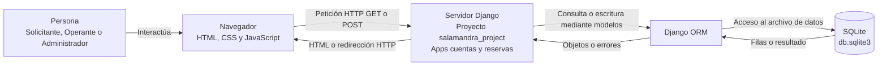
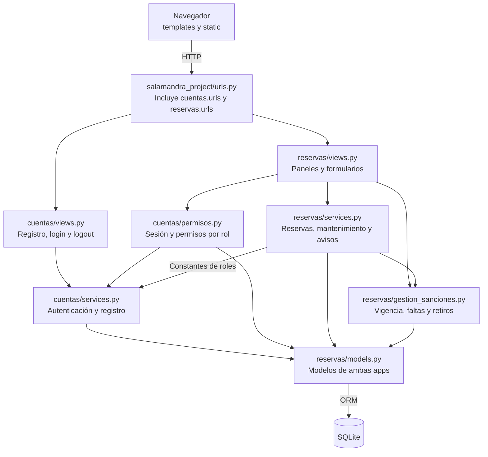
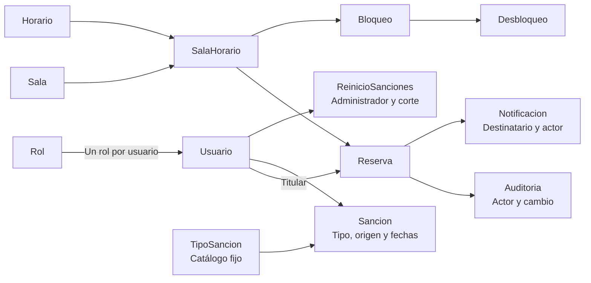

# Arquitectura de SalaMandra

- Actualización: 1 de noviembre de 2026.
- Alcance: arquitectura de la aplicación web existente, sin modificar su implementación.
- Lectura relacionada: [requisitos](sesion-06-requisitos.md), [historias y casos de uso](sesion-07-modelos.md), [recorridos de interacción](session20.md), [trazabilidad de pruebas](trazabilidad-pruebas.md) y [actividad de sesión 12](sesion-12-arquitectura.md).

## 1. Contexto y alcance

SalaMandra permite gestionar reservas de salas de estudio mediante tres roles: Solicitante, Operante y Administrador. Es una aplicación Django con dos apps internas, `cuentas` y `reservas`, dentro de un mismo proyecto y proceso de servidor. No son dos servidores ni microservicios independientes.

El Solicitante gestiona sus reservas propias y avisos. El Operante gestiona reservas para un Solicitante activo y registrado y administra mantenimiento con restricciones temporales. El Administrador puede reservar para sí mismo, gestionar reservas con excepciones autorizadas y administrar mantenimiento, sanciones y cuentas. Las altas y retiros de salas y horarios están deshabilitados y corresponden a futuros alcances.

La regla funcional de calendario prohíbe reservas sábados, domingos y feriados configurados. El cálculo de vencimiento de sanciones fijas omite sábados y domingos y es independiente del calendario de reservas. Las reglas detalladas pertenecen a la sesión 06, no se redefinen en este documento.

## 2. Vista de ejecución y despliegue local

En desarrollo, el servidor se inicia con `python manage.py runserver`. SQLite es un archivo local configurado en `salamandra_project/settings.py`, no un servidor PostgreSQL separado. Este esquema describe el entorno local, no certifica un despliegue de producción.

El navegador recibe la interfaz y ejecuta los scripts de selección de horarios. CSS contiene las reglas responsive. La validación definitiva de una reserva ocurre en el servidor aunque el navegador oculte o deshabilite botones.

## 3. Componentes, responsabilidades y dependencias

Las flechas de este diagrama representan dependencias, no pasos cronológicos. Los diagramas de secuencia y los recorridos de sesión 20 explican el orden de ejecución.

| Componente | Responsabilidad | Dependencia principal |
|---|---|---|
| `salamandra_project/` | Configurar apps, URLs, middleware, sesión, zona horaria y SQLite. | Django y configuración del entorno. |
| Plantillas y estáticos | Mostrar formularios, tablas, avisos y adaptar la interfaz. | Contexto enviado por las vistas. |
| `cuentas/views.py` | Recibir registro, credenciales y salida de sesión. | Servicios de cuentas. |
| `cuentas/services.py` | Activar credenciales precargadas, verificar hash y consultar roles. | `Usuario` y `Rol`, definidos en reservas. |
| `cuentas/permisos.py` | Validar sesión y rol antes de entrar a las vistas. | Sesión y modelos de usuario. |
| `reservas/views.py` | Leer GET/POST, coordinar operaciones, mensajes, render y redirecciones. | Permisos, servicios y algunas consultas ORM para contexto. |
| `reservas/services.py` | Crear, modificar y cancelar, mantenimiento, paneles y avisos. | Modelos, gestión de sanciones y constantes de roles de cuentas. |
| `reservas/gestion_sanciones.py` | Calcular vencimientos y faltas, aplicar o retirar sanciones y reiniciar. También contiene gestión de estado de cuentas. | Modelos y hora local. |
| `reservas/models.py` | Representar datos, relaciones y restricciones persistentes. | ORM y SQLite. |
| Comandos de gestión | Cargar datos iniciales y convertir fechas de bases antiguas. | ORM o conexión SQLite según el comando. |
| `tests/` | Invocar vistas, servicios y modelos y comprobar resultados. | pytest, pytest-django y base de prueba. |

Las capas son una organización de responsabilidades, no una separación absoluta: algunas vistas consultan modelos directamente. Las reglas están dentro de los servicios y sus funciones auxiliares, no en un `rules.py` de la aplicación web. Los formularios actuales se leen con `request.POST`, sin un `forms.py` propio. La carpeta `proyecto/` conserva una implementación anterior en Python y no es una dependencia de las vistas web actuales.

## 4. Contratos entre capas

| Entrada desde presentación | Servicio principal | Resultado para la vista |
|---|---|---|
| Código, correo y contraseña validada | `register_student_account()` | `Usuario` o `RegistrationError`. |
| Código y contraseña | `authenticate_user()` | `Usuario` o `None`. |
| Actor, titular, bloque y actividad | `create_reservation()` | `Reserva` o error. Actor y titular pueden ser diferentes. |
| Actor, reserva y destino | `modify_reservation()` | `Reserva` modificada o rechazo que conserva el origen. |
| Actor e ID de reserva | `cancel_reservation()` | Diccionario con reserva y sanción opcional. |
| Actor, bloque y motivo | `block_room_schedule_for_maintenance()` | Bloque y lista de reservas afectadas. |
| Actor e ID de bloque | `unblock_room_schedule_from_maintenance()` | `SalaHorario` habilitado o error temporal/de permisos. |
| Administrador, titular, duración y motivo | `apply_manual_sanction()` | `Sancion` o `GestionSancionesError`. |
| Administrador | `clear_all_sanctions()` | Cantidad de sanciones retiradas y corte de conteo persistido. |

Las vistas convierten los resultados en HTML o redirecciones y los errores previstos en mensajes. Un servicio no renderiza HTML. Las pruebas llaman al código de la aplicación, la aplicación no llama a las pruebas.

## 5. Datos e integridad

Este es un mapa simplificado de asociaciones, no un diagrama entidad-relación con todas las claves y cardinalidades. Las definiciones completas están en `reservas/models.py`; los diagramas existentes se encuentran en `docs/diagramas/entidad-relacion/`.

- La reserva referencia un `SalaHorario`, que relaciona sala e intervalo.
- `uq_reserva_activa_horario_fecha` impide dos reservas activas para el mismo bloque y fecha. Incluye `CONFIRMADA` y `EN_USO` en su condición, aunque el flujo ordinario use `CONFIRMADA`, `CANCELADA` y `POR_MANTENIMIENTO`.
- Los servicios de escritura principales usan `transaction.atomic`: reserva, auditoría y avisos se confirman juntos o se revierten.
- Para creación y modificación se realiza una escritura sobre el bloque antes de validar para coordinar las escrituras de SQLite. No cambia el estado a mantenimiento ni garantiza por sí sola cualquier escenario concurrente.
- La auditoría conserva actor y titular diferenciados. Retirar sanciones completa `fecha_retiro` y responsable sin borrar la fecha de fin original.
- Mantenimiento afecta las reservas confirmadas asociadas en todas sus fechas. Habilitar el bloque no las restaura.

## 6. Seguridad, sesión y tiempo

- El registro activa una cuenta precargada y almacena un hash, no la contraseña en texto plano.
- La sesión usa cookies firmadas con duración configurada de cuatro horas; una cookie firmada protege integridad, no cifra su contenido.
- Los decoradores comprueban usuario activo y permisos. `student_panel_view()` restringe explícitamente el panel a Solicitante y Administrador.
- El Operante necesita un estudiante activo con cuenta registrada. La comprobación existe en búsqueda y servicios.
- Los formularios de cambio utilizan POST y token CSRF. La disponibilidad visual no sustituye la validación del servidor.
- La zona configurada es `America/La_Paz`; los mensajes de sanción muestran vencimiento local.
- Las credenciales y opciones de desarrollo de `settings.py` no constituyen una configuración de producción revisada.

## 7. Decisiones y límites

| Decisión | Motivo | Límite o consecuencia |
|---|---|---|
| Dos apps en un proyecto | Separar acceso y operaciones del sistema. | Comparten modelos y proceso, no son servicios autónomos. |
| Servicios comunes por operación | Evitar duplicar reglas entre roles. | Los permisos y excepciones deben comprobarse según actor y titular. |
| SQLite y ORM | Persistencia local sencilla con restricciones. | Serializa escrituras y puede producir errores de bloqueo. |
| Transacciones y auditoría | Evitar operaciones parciales y conservar trazabilidad. | Un fallo de auditoría debe revertir la operación. |
| Historial conservado | Permitir revisión de sanciones y mantenimiento. | Retirar no equivale a borrar ni a restaurar reservas. |
| Cálculo semestral por fecha | No depender de un proceso encendido a medianoche. | No crea un reinicio manual ni completa un retiro automático. |
| Notificaciones internas | Informar cambios dentro del panel. | No envía correos ni avisos persistentes al aplicar sanción manual. |

La cobertura y las pruebas automatizadas se describen en [trazabilidad](trazabilidad-pruebas.md). Un test HTTP con el cliente de Django no ejecuta JavaScript ni demuestra por sí solo comportamiento visual, concurrencia real o preparación para producción.

## 8. Futuros alcances

Crear salas, asignar nuevos horarios y retirar asignaciones de forma administrable. Existe código de soporte en `gestion_salas.py`, pero `GESTION_SALAS_HABILITADA=False` mantiene esa función fuera del alcance disponible. Su habilitación requiere revisión y verificación propias.
