# Sesión 7 — Historias y casos de uso

- Proyecto: SalaMandra — Reserva de Salas de Estudio
- Integrantes: Luciana Soza (@luci-solar34), Sebastian Cruz (@Sebas0032), Sebastian Soto (@sebas-sst)
- Requisitos de origen: [Sesión 6](sesion-06-requisitos.md)
- Historias incluidas: RES-HU-01 a RES-HU-12
- Casos de uso incluidos: RES-CU-01 a RES-CU-12; RES-CU-04 se divide en cuatro casos principales del Operante (A–D)

---

## Roles del sistema

Cada usuario tiene exactamente un rol. Un rol puede estar asignado a varios usuarios, pero una misma cuenta no puede ser simultáneamente Solicitante, Operante y Administrador.

| Rol | Responsabilidad principal |
|---|---|
| **Solicitante** | Consultar disponibilidad; crear, modificar y cancelar sus propias reservas; consultar y marcar sus notificaciones internas como leídas. |
| **Operante** | Crear, modificar y cancelar reservas en nombre de un Solicitante identificado por su código institucional; bloquear y desbloquear horarios por mantenimiento. No puede crear horarios ni aplicar sanciones manuales. |
| **Administrador** | Reservar para su propia cuenta y gestionar reservas con las excepciones autorizadas; administrar mantenimiento, salas, horarios, sanciones y cuentas de solicitantes. Puede reiniciar contadores y retirar sanciones sin borrar el historial. |

### Permisos por caso de uso

| Caso de uso | Solicitante | Operante | Administrador |
|---|:---:|:---:|:---:|
| RES-CU-01 Crear reserva propia | Sí | No | Sí, para sí mismo |
| RES-CU-02 Modificar reserva propia | Sí | No | No |
| RES-CU-03 Cancelar reserva propia | Sí | No | No |
| RES-CU-04A Crear reserva asistida | No | Sí | No |
| RES-CU-04B Modificar reserva asistida | No | Sí | No |
| RES-CU-04C Cancelar reserva asistida | No | Sí | No |
| RES-CU-04D Gestionar mantenimiento | No | Sí | No |
| RES-CU-05 Consultar disponibilidad y notificaciones | Sí | Sí | Sí |
| RES-CU-06 Modificar reserva administrativamente | No | No | Sí |
| RES-CU-07 Gestionar mantenimiento administrativamente | No | No | Sí |
| RES-CU-08 Cancelar reserva administrativamente | No | No | Sí |
| RES-CU-09 Gestionar sanciones y cuentas | No | No | Sí |
| RES-CU-10 Gestionar salas y horarios | No | No | Sí |
| RES-CU-11 Crear cuenta de Solicitante | Sí | No | No |
| RES-CU-12 Iniciar sesión | Sí | Sí | Sí |

---

## Reglas generales del negocio

1. **Rol único:** cada cuenta referencia un solo rol: Administrador, Operante o Solicitante.
2. **Reservas del día:** únicamente se reservan horarios disponibles del día actual; no se admiten reservas futuras ni bloques que ya finalizaron.
3. **Días habilitados:** no se permiten reservas los sábados, domingos ni en las fechas configuradas en `RESERVAS_FERIADOS`.
4. **Actividades permitidas:** Tutoría, Examen, Tarea o Proyecto. La selección es obligatoria.
5. **Horarios configurables:** A–F son la configuración inicial. Un Administrador puede agregar horarios de al menos 120 minutos, sin duplicados ni superposiciones y con 15 minutos de separación.
6. **Reservas no consecutivas:** un Solicitante no puede tener reservas en el mismo bloque ni en bloques consecutivos, aunque sean de salas diferentes. El Administrador puede reservar bloques consecutivos para su propia cuenta.
7. **Modificación:** Solicitante y Operante necesitan al menos 60 minutos de anticipación. El Administrador no tiene ese límite y puede exceptuar la consecutividad, pero debe respetar ocupación, limpieza, mantenimiento y las demás reglas. Se rechaza elegir exactamente el mismo `SalaHorario`; si falla, la reserva original se conserva. La auditoría guarda origen y destino y, cuando modifica un tercero autorizado, se notifica al titular.
8. **Cancelación:** el Solicitante y el Operante solo cancelan antes del inicio. Si el propio Solicitante cancela con menos de 60 minutos, recibe la sanción automática. La cancelación del Operante nunca sanciona al titular y genera una notificación. El Administrador puede cancelar incluso una reserva iniciada, también sin sancionar.
9. **Escala y vigencia:** primera falta 24 horas, segunda 48 horas, tercera una semana y cuarta hasta el siguiente corte semestral. La duración del tipo semestral es `NULL`; su `fecha_fin` se calcula para el 1 de enero o el 1 de julio. Al aplicar una nueva sanción se retira la vigente y se conserva su historial, por lo que solo una permanece activa.
10. **Conteo semestral y reinicio:** las faltas se cuentan desde el 1 de enero o el 1 de julio, o desde el último reinicio general manual del período. El cambio semestral es automático y no crea un registro de reinicio. El reinicio manual sí crea `ReinicioSanciones`, retira sanciones vigentes y conserva el historial.
11. **Mantenimiento:** el Operante solo puede bloquear antes del inicio; el Administrador puede bloquear antes, durante o después del turno. Ambos solo pueden retirar el bloqueo antes del inicio del horario en la fecha original del bloqueo. Desde ese momento se rechaza el desbloqueo, incluso en días posteriores. El estado `MANTENIMIENTO` no vence automáticamente.
12. **Reservas afectadas:** al bloquear por mantenimiento, las reservas `CONFIRMADA` asociadas pasan a `POR_MANTENIMIENTO`, sin sanción, y generan una notificación interna con el motivo.
13. **Estados:** `Reserva` utiliza `CONFIRMADA`, `CANCELADA` y `POR_MANTENIMIENTO`; `SalaHorario` utiliza `DISPONIBLE`, `MANTENIMIENTO` y `RETIRADO`.
14. **Trazabilidad:** crear, modificar y cancelar una reserva genera una fila de `Auditoria` con la reserva, el actor, la acción y la fecha. El titular y el actor pueden ser usuarios distintos.
15. **Notificaciones persistentes:** se almacenan individualmente las cancelaciones por mantenimiento, las cancelaciones gestionadas por Administrador u Operante y las modificaciones realizadas por esos actores. Una modificación informa sala y horario anteriores y nuevos. Marcar una notificación como leída no la elimina y no se envían correos.
16. **Concurrencia:** la creación y modificación se ejecutan en una transacción. La base de datos impide dos reservas activas para la misma combinación de fecha y `SalaHorario`.

---

## 1. Historia RES-HU-01

Como Solicitante, quiero reservar una sala disponible para hoy, de modo que pueda utilizarla para una actividad académica sin conflictos con otras reservas.

- Requisitos relacionados: RES-RF-04, RES-RF-06, RES-RF-08, RES-RF-09, RES-RF-12 y RES-RF-16.

---

## 2. Caso de uso RES-CU-01 — Crear una reserva propia

- **Objetivo:** registrar una reserva propia aplicando las reglas de disponibilidad, calendario y sanciones.
- **Actor principal:** Solicitante; el Administrador también puede reservar para su propia cuenta.
- **Disparador:** el Solicitante selecciona una sala, un horario y una actividad y confirma la operación.
- **Precondiciones:** cuenta activa con rol Solicitante o Administrador; sesión iniciada; día habilitado.
- **Poscondición de éxito:** se crean `Reserva(CONFIRMADA)` y `Auditoria(CREAR)` dentro de la misma transacción.
- **Garantía ante rechazo:** no se crea la reserva ni la auditoría; los datos existentes permanecen sin cambios.

### Flujo principal

1. El Solicitante abre su panel y consulta los bloques de hoy.
2. Selecciona un `SalaHorario` disponible y una actividad permitida.
3. La vista obtiene de la sesión el código del Solicitante y llama al servicio de creación.
4. El servicio bloquea lógicamente el `SalaHorario` durante la transacción y recupera actor, titular, sala y horario.
5. Valida día hábil, sanciones vigentes, actividad, estado del horario, hora de finalización, ocupación, bloques consecutivos e intervalo de limpieza. Si el actor es Administrador y reserva para sí mismo, omite solo la consecutividad.
6. Crea la reserva con fecha de hoy y estado `CONFIRMADA`.
7. Registra la acción `CREAR` en `Auditoria` usando al Solicitante como actor.
8. La transacción confirma y la vista muestra el resultado.

### Flujos alternativos y excepciones

- **A1 — Sanción activa:** se rechaza e informa motivo y tiempo restante.
- **A2 — Día o bloque no habilitado:** se rechaza si es fin de semana, feriado, el bloque terminó o está en mantenimiento.
- **A3 — Conflicto del Solicitante:** se rechaza una reserva en el mismo bloque o en uno consecutivo.
- **A4 — Conflicto concurrente:** si otra transacción confirmó primero, la restricción única impide duplicar la reserva.

### Diagrama de secuencia de bajo nivel — RES-CU-01

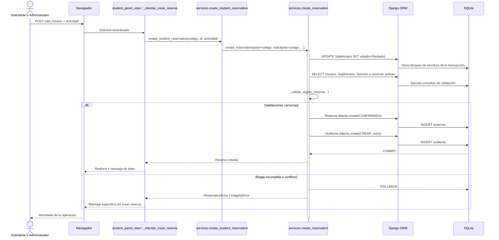

---

## 3. Historia RES-HU-02

Como Solicitante, quiero cambiar la sala o el horario de una reserva confirmada, de modo que pueda adaptarla sin perder la reserva original si el cambio falla.

- Requisitos relacionados: RES-RF-01, RES-RF-10 y RES-RF-16.

---

## 4. Caso de uso RES-CU-02 — Modificar una reserva propia

- **Objetivo:** cambiar el `SalaHorario` de una reserva confirmada con al menos 60 minutos de anticipación.
- **Actor principal:** Solicitante.
- **Disparador:** el Solicitante selecciona otro bloque y guarda los cambios.
- **Precondiciones:** la reserva pertenece al actor, está `CONFIRMADA` y todavía puede modificarse.
- **Poscondición de éxito:** la reserva referencia el nuevo `SalaHorario` y se registra `Auditoria(MODIFICAR)`.
- **Garantía ante rechazo:** la reserva conserva su sala y horario originales.

### Flujo principal

1. El sistema carga la reserva y los bloques alternativos disponibles.
2. El Solicitante selecciona el nuevo `SalaHorario`.
3. El servicio obtiene la reserva con `select_for_update()` y valida pertenencia y anticipación.
4. Bloquea el nuevo `SalaHorario` durante la transacción.
5. Reutiliza las reglas de creación, excluyendo la reserva que se modifica.
6. Solo después de superar todas las validaciones actualiza `reserva.sala_horario`.
7. Crea `Auditoria(MODIFICAR)` y confirma la transacción.

### Flujos alternativos y excepciones

- **A1 — Menos de 60 minutos:** se rechaza y conserva la reserva original.
- **A2 — Reserva ajena o no confirmada:** se rechaza sin exponer ni modificar datos.
- **A3 — Nuevo bloque ocupado, consecutivo o en mantenimiento:** se revierte la transacción.

### Diagrama de secuencia de bajo nivel — RES-CU-02

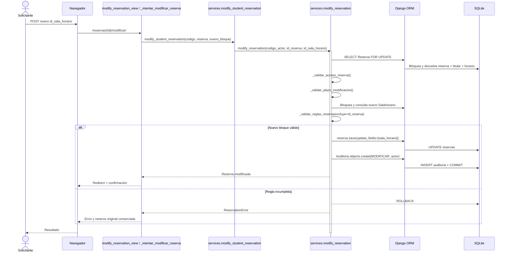

---

## 5. Historia RES-HU-03

Como Solicitante, quiero cancelar una reserva antes de que comience y conocer si la cancelación será sancionada, de modo que pueda decidir conscientemente.

- Requisitos relacionados: RES-RF-02, RES-RF-15, RES-RF-23 y RES-RF-24.

---

## 6. Caso de uso RES-CU-03 — Cancelar una reserva propia

- **Objetivo:** cancelar una reserva confirmada y aplicar la escala automática cuando faltan menos de 60 minutos.
- **Actor principal:** Solicitante.
- **Disparador:** el Solicitante confirma la cancelación desde su panel.
- **Precondiciones:** la reserva pertenece al Solicitante, está confirmada y todavía no comenzó.
- **Poscondición de éxito:** la reserva queda `CANCELADA`, se registra `Auditoria(CANCELAR)` y, si corresponde, se crea una `Sancion(AUTOMATICA)`.
- **Garantía ante rechazo:** no cambia la reserva ni se registra una sanción.

### Flujo principal

1. La interfaz advierte, cuando corresponde, que una cancelación tardía genera falta y sanción.
2. Si el usuario confirma, la vista llama a `cancel_reservation()` con el actor autenticado.
3. El servicio obtiene la reserva confirmada mediante `select_for_update()` y valida pertenencia e inicio.
4. Actualiza el estado a `CANCELADA`.
5. Si faltan menos de 60 minutos, cuenta las faltas automáticas del semestre, selecciona el tipo de sanción, retira cualquier sanción vigente y crea la nueva sanción automática.
6. Registra `Auditoria(CANCELAR)` y confirma la transacción.

### Flujos alternativos y excepciones

- **A1 — Usuario vuelve atrás:** el navegador no envía el POST y no hay cambios.
- **A2 — Reserva iniciada:** el servidor rechaza la cancelación aunque la interfaz estuviera desactualizada.
- **A3 — Cancelación con 60 minutos o más:** se cancela sin crear sanción.

### Diagrama de secuencia de bajo nivel — RES-CU-03

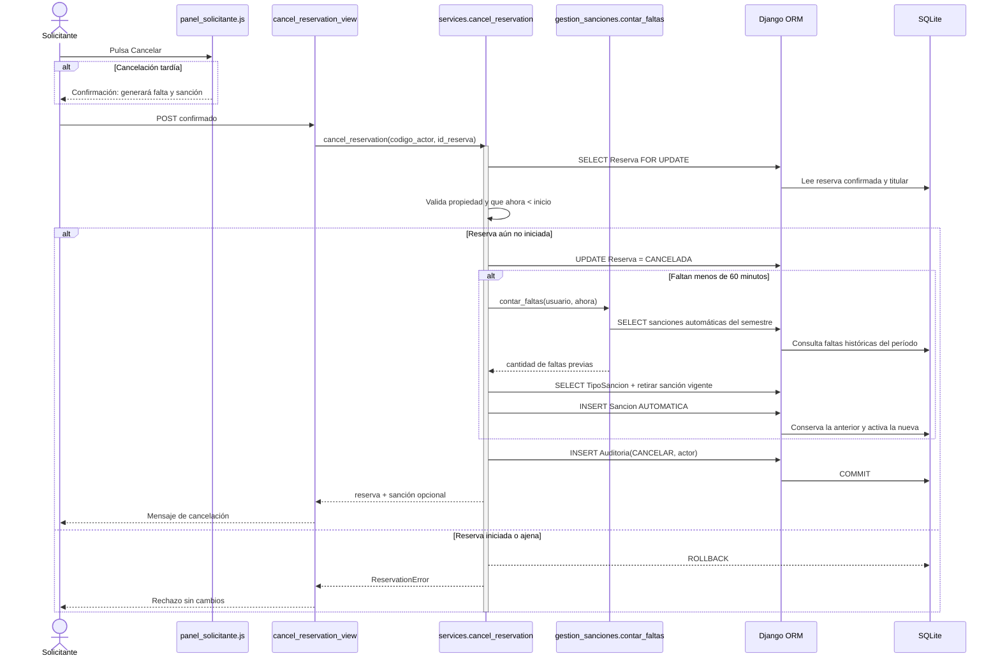

---

## 7. Historia RES-HU-04

Como Operante, quiero crear, modificar y cancelar reservas para un Solicitante identificado por su código institucional, y poner horarios en mantenimiento, de modo que pueda asistir la operación diaria conservando la identidad de quien ejecutó cada acción.

- Requisitos relacionados: RES-RF-03, RES-RF-05, RES-RF-10, RES-RF-13, RES-RF-17, RES-RF-18, RES-RF-19, RES-RF-21 y RES-RF-22.
- Esta historia se mantiene en **cuatro casos de uso principales**: crear, modificar, cancelar y mantenimiento.

---

## 8. Casos de uso de RES-HU-04 — Operante

### RES-CU-04A — Crear una reserva mediante el código del Solicitante

- **Objetivo:** crear una reserva cuyo titular sea un Solicitante y cuyo actor auditado sea el Operante.
- **Precondiciones:** Operante autenticado; código correspondiente a un Solicitante activo; bloque del día disponible.
- **Poscondición de éxito:** `Reserva.usuario` identifica al Solicitante y `Auditoria.actor` al Operante.

1. El Operante introduce el código institucional y el sistema autocompleta los datos del Solicitante.
2. Selecciona sala, horario y actividad.
3. `create_reservation()` vuelve a validar actor, titular, sanción, calendario, disponibilidad, consecutividad y limpieza.
4. Crea `Reserva(CONFIRMADA)` y `Auditoria(CREAR)` en una transacción.

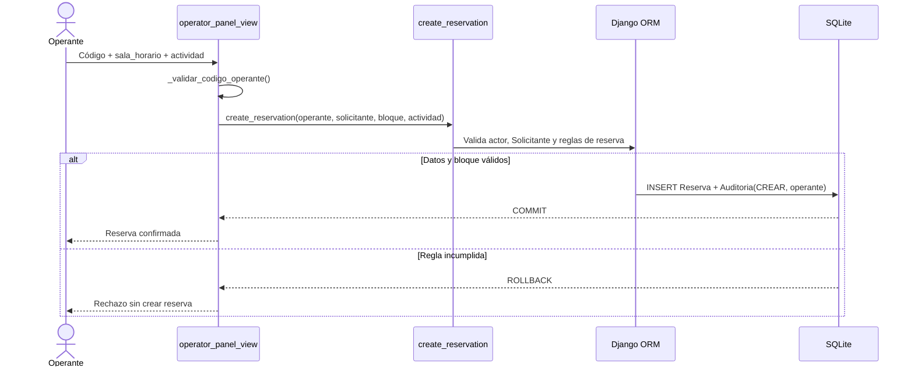

### RES-CU-04B — Modificar una reserva del Solicitante

- **Objetivo:** cambiar la sala o el horario de una reserva del Solicitante con al menos 60 minutos de anticipación.
- **Precondiciones:** reserva `CONFIRMADA` perteneciente al código buscado; nuevo `SalaHorario` diferente del actual.
- **Poscondición de éxito:** se conserva al titular, se auditan origen, destino y Operante y se crea `Notificacion(MODIFICACION_GESTION)`.

1. El Operante selecciona una reserva del Solicitante y un destino diferente.
2. La vista comprueba que la reserva pertenece al código buscado.
3. `modify_reservation()` valida el plazo, disponibilidad, sanciones, consecutividad y limpieza.
4. Solo tras superar las reglas actualiza la reserva, registra ambos `SalaHorario` en auditoría y notifica al titular.

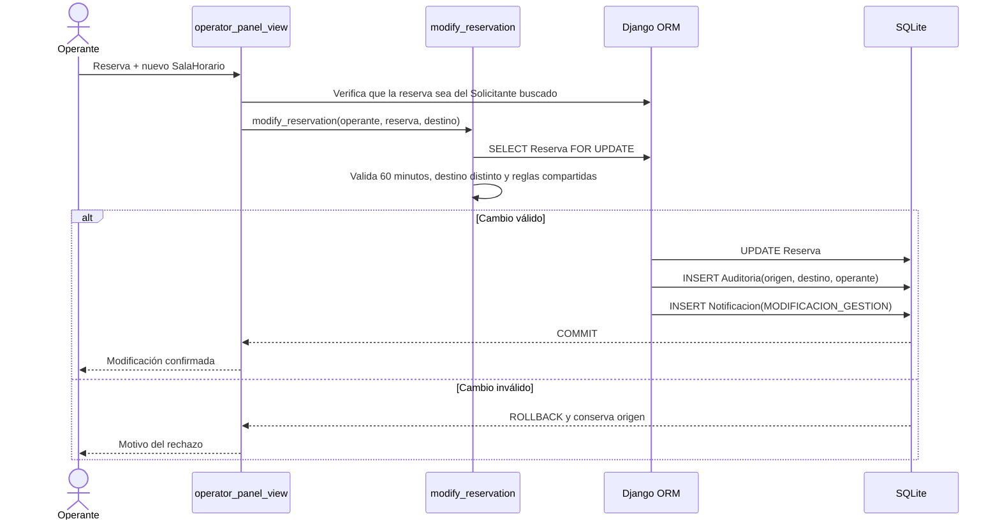

### RES-CU-04C — Cancelar una reserva del Solicitante

- **Objetivo:** cancelar antes de su inicio una reserva del Solicitante sin generar falta ni sanción.
- **Precondiciones:** reserva `CONFIRMADA`, no iniciada y perteneciente al código buscado.
- **Poscondición de éxito:** reserva `CANCELADA`, auditoría con actor Operante y notificación al titular; ninguna sanción nueva, aunque falten menos de 60 minutos.

1. La interfaz informa que la cancelación se registrará y no sancionará al Solicitante.
2. La vista comprueba la pertenencia y llama a `cancel_reservation()`.
3. El servicio rechaza reservas iniciadas o no confirmadas.
4. Actualiza el estado, omite la sanción porque el actor es Operante y crea auditoría y notificación.

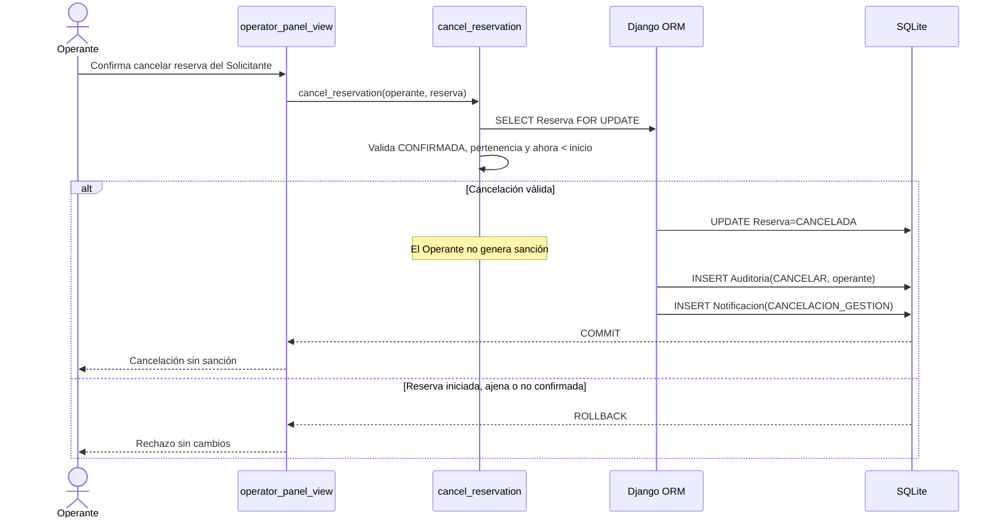

### RES-CU-04D — Poner un horario en mantenimiento

- **Objetivo:** impedir nuevas reservas en un `SalaHorario` antes de su inicio y gestionar sin sanciones las reservas afectadas.
- **Precondiciones:** Operante autenticado; horario existente, no iniciado y fuera de mantenimiento; motivo obligatorio.
- **Poscondición de éxito:** `SalaHorario(MANTENIMIENTO)`, `Bloqueo` registrado y reservas afectadas en `POR_MANTENIMIENTO`, con auditoría y notificación.

1. El Operante selecciona sala, horario y motivo; no necesita introducir un código de Solicitante.
2. `block_room_schedule_for_maintenance()` valida permisos, estado y que el turno no haya comenzado.
3. Cambia las reservas confirmadas afectadas a `POR_MANTENIMIENTO`, sin sanciones, y genera sus auditorías y notificaciones.
4. Cambia el horario a `MANTENIMIENTO` y crea `Bloqueo` con actor, motivo y fecha.
5. Como acción secundaria del mismo mantenimiento, el Operante puede retirarlo solo antes del inicio correspondiente a la fecha original del bloqueo; después se rechaza permanentemente y el estado no vence solo.

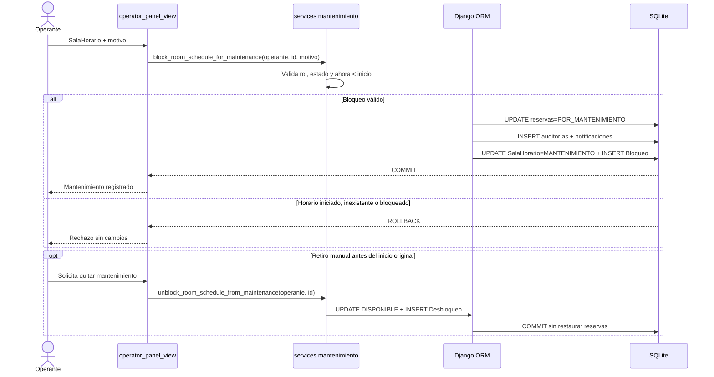

---

## 9. Historia RES-HU-05

Como usuario autenticado, quiero consultar la disponibilidad actual y, como Solicitante, revisar mis reservas y notificaciones, de modo que conozca el estado vigente del sistema.

- Requisitos relacionados: RES-RF-04, RES-RF-07, RES-RF-11 y RES-RF-22.

---

## 10. Caso de uso RES-CU-05 — Consultar disponibilidad y notificaciones

- **Objetivo:** construir el panel del día actual con salas, horarios, reservas y avisos persistentes.
- **Actor principal:** usuario autenticado.
- **Disparador:** el usuario abre el panel de salas.
- **Precondiciones:** sesión válida.
- **Poscondición de éxito:** se muestra información de solo lectura; opcionalmente una notificación del Solicitante queda marcada como leída.
- **Garantía ante rechazo:** una notificación ajena no puede consultarse ni modificarse.

### Flujo principal

1. La vista obtiene el código de la sesión y llama a `get_student_panel()`.
2. El servicio consulta reservas del día, salas, horarios y estados de mantenimiento.
3. Construye cada bloque como disponible, reservado, finalizado o mantenimiento.
4. Si el usuario es Solicitante, agrega sus reservas y notificaciones ordenadas por fecha.
5. La vista renderiza el panel.
6. Si el Solicitante pulsa “Entendido”, se llama a `mark_notification_as_read()`.
7. El servicio busca la notificación por ID y destinatario y actualiza únicamente `leida=True`.

### Flujos alternativos y excepciones

- **A1 — Usuario sancionado:** puede consultar el panel, aunque otro caso de uso le impida reservar.
- **A2 — Notificación ajena o inexistente:** se rechaza y no se modifica ningún registro.

### Diagrama de secuencia de bajo nivel — RES-CU-05

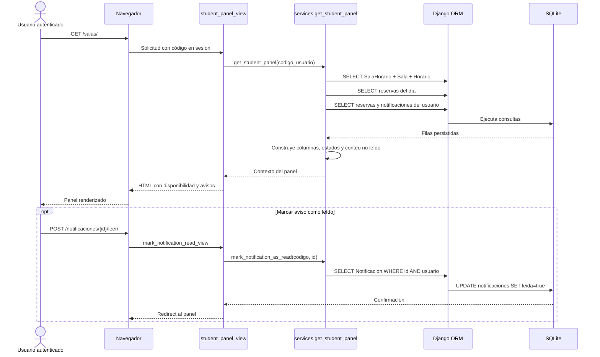

---

## 11. Historia RES-HU-06

Como Administrador, quiero modificar una reserva con las excepciones autorizadas, de modo que pueda resolver cambios operativos manteniendo disponibilidad, trazabilidad y aviso al titular.

- Requisitos relacionados: RES-RF-01, RES-RF-08, RES-RF-10, RES-RF-13 y RES-RF-22.

---

## 12. Caso de uso RES-CU-06 — Modificar una reserva administrativamente

- **Objetivo:** cambiar el `SalaHorario` de una reserva confirmada sin el límite ordinario de 60 minutos ni la restricción de consecutividad.
- **Actor principal:** Administrador.
- **Precondiciones:** Administrador activo; reserva `CONFIRMADA`; destino diferente del actual.
- **Poscondición de éxito:** reserva modificada, auditoría con origen, destino y Administrador, y notificación persistente al titular.
- **Garantía ante rechazo:** ocupación, limpieza, mantenimiento, sanción o destino inválido conservan la reserva original.

### Flujo principal

1. El Administrador consulta las reservas confirmadas y elige modificar una.
2. `modify_reservation()` comprueba el permiso administrativo y omite la validación de 60 minutos.
3. Valida que el destino sea distinto, esté disponible y respete limpieza y las demás reglas; permite bloques consecutivos por la excepción administrativa.
4. Actualiza la reserva, guarda `sala_horario_anterior` y `sala_horario_nuevo` en `Auditoria` y crea `Notificacion(MODIFICACION_GESTION)`.

### Diagrama de secuencia de bajo nivel — RES-CU-06

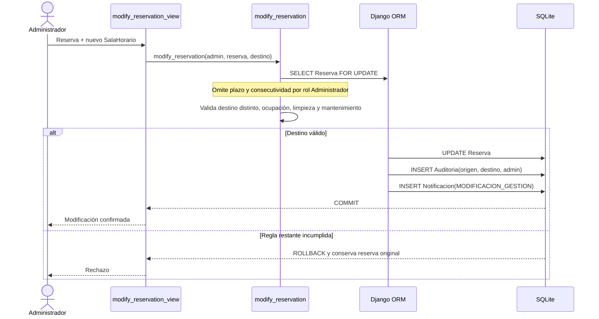

---

## 13. Historia RES-HU-07

Como Administrador, quiero gestionar bloqueos de mantenimiento incluso si el turno comenzó o terminó, de modo que el estado operativo quede registrado y las reservas afectadas sean informadas sin sanciones.

- Requisitos relacionados: RES-RF-03, RES-RF-13, RES-RF-17, RES-RF-21 y RES-RF-22.

---

## 14. Caso de uso RES-CU-07 — Gestionar mantenimiento administrativamente

- **Objetivo:** bloquear un `SalaHorario` antes, durante o después del turno y retirarlo solo cuando la regla temporal lo permita.
- **Actor principal:** Administrador.
- **Precondiciones de bloqueo:** Administrador activo; horario existente y fuera de mantenimiento; motivo obligatorio.
- **Poscondición de bloqueo:** `SalaHorario(MANTENIMIENTO)`, `Bloqueo` registrado y reservas confirmadas afectadas en `POR_MANTENIMIENTO`, con auditoría y notificación.
- **Poscondición de desbloqueo válido:** `SalaHorario(DISPONIBLE)` y un único `Desbloqueo`; las reservas afectadas no se restauran.

### Flujo principal

1. El Administrador selecciona sala, horario y motivo.
2. `block_room_schedule_for_maintenance()` valida el rol y permite el bloqueo aunque el turno ya haya comenzado o finalizado.
3. Cambia reservas confirmadas a `POR_MANTENIMIENTO`, sin sanción, y crea auditorías y notificaciones con el motivo.
4. Cambia el horario a `MANTENIMIENTO` y registra responsable, motivo y fecha en `Bloqueo`.
5. El estado persiste al finalizar el turno y al cambiar la fecha.
6. Para retirarlo, `can_unblock_maintenance()` compara el momento actual con el inicio del horario en la fecha original del bloqueo.
7. Solo si todavía es anterior crea `Desbloqueo` y vuelve a `DISPONIBLE`; desde el inicio se rechaza para siempre, aunque hayan pasado días.

### Flujos alternativos y excepciones

- **A1 — Administrador bloquea un turno iniciado o finalizado:** se permite; por haberse superado el inicio original, ese bloqueo no podrá retirarse mediante esta operación.
- **A2 — Horario ya bloqueado:** se rechaza sin duplicar el bloqueo.
- **A3 — Retiro posterior al inicio original:** se rechaza y el mantenimiento permanece activo.
- **A4 — Retiro válido:** no reactiva reservas `POR_MANTENIMIENTO` ni elimina notificaciones o historial.

### Diagrama de secuencia de bajo nivel — RES-CU-07

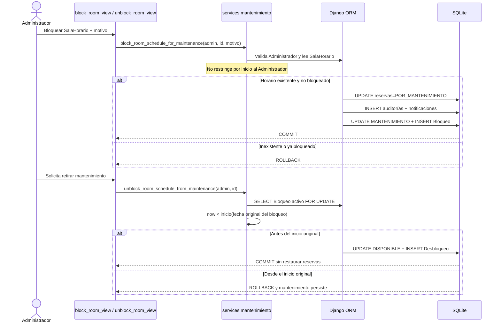

---

## 15. Historia RES-HU-08

Como Administrador, quiero cancelar una reserva confirmada por razones de gestión, incluso si ya comenzó, de modo que quede registro de mi acción y el titular sea informado sin sanción.

- Requisitos relacionados: RES-RF-13, RES-RF-20 y RES-RF-22.

---

## 16. Caso de uso RES-CU-08 — Cancelar una reserva administrativamente

- **Objetivo:** cancelar una reserva confirmada, iniciada o no, sin penalizar al titular.
- **Actor principal:** Administrador.
- **Disparador:** el Administrador elige una reserva en la gestión de cancelaciones.
- **Precondiciones:** reserva `CONFIRMADA`; cuenta Administrador activa.
- **Poscondición de éxito:** reserva `CANCELADA`, auditoría con actor Administrador y notificación interna al titular; ninguna sanción nueva.
- **Garantía ante rechazo:** reservas canceladas, afectadas por mantenimiento o inexistentes no se alteran.

### Flujo principal

1. La vista obtiene las reservas cancelables mediante `get_admin_cancellable_reservations()`.
2. El Administrador selecciona una reserva.
3. La vista llama a `cancel_reservation()` con el código del Administrador.
4. El servicio bloquea la reserva y valida que continúe confirmada; el Administrador está exceptuado de la restricción de inicio.
5. Actualiza el estado a `CANCELADA`.
6. Omite la sanción porque el actor tiene rol Administrador.
7. Crea `Auditoria(CANCELAR)` y `Notificacion(CANCELACION_GESTION)` para el titular.

### Flujos alternativos y excepciones

- **A1 — La reserva ya comenzó:** la cancelación administrativa sigue permitida y no sanciona.
- **A2 — La reserva dejó de estar confirmada:** se rechaza sin alterar su estado actual.
- **A3 — Actor no Administrador:** el decorador impide entrar a la gestión administrativa.

### Diagrama de secuencia de bajo nivel — RES-CU-08

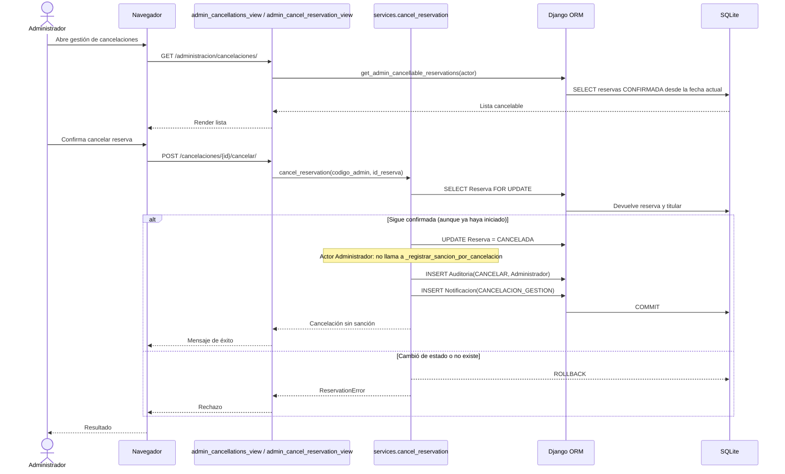

---

## 17. Historia RES-HU-09

Como Administrador, quiero gestionar sanciones, reiniciar contadores y activar o desactivar cuentas de Solicitantes, de modo que pueda administrar incumplimientos y accesos sin eliminar el historial.

- Requisitos relacionados: RES-RF-13, RES-RF-14, RES-RF-15 y RES-RF-23.

---

## 18. Caso de uso RES-CU-09 — Gestionar sanciones y cuentas de Solicitantes

- **Objetivo:** aplicar o retirar sanciones, realizar un reinicio general extraordinario y cambiar el estado de una cuenta, conservando toda la trazabilidad.
- **Actor principal:** Administrador.
- **Disparador:** el Administrador selecciona aplicar, retirar, reiniciar contadores, activar o desactivar.
- **Precondiciones:** Administrador activo; Solicitante existente; catálogo de sanciones cargado.
- **Poscondición de éxito:** la operación queda persistida sin borrar sanciones ni modificar sus datos históricos originales.
- **Garantía ante rechazo:** no se crean sanciones incompletas ni se elimina historial.

### Flujo principal

1. El panel llama a `get_solicitantes()` para mostrar estado y sanciones vigentes.
2. Para aplicar, selecciona 24 horas, 48 horas, una semana o semestre y escribe el motivo obligatorio.
3. `apply_manual_sanction()` retira primero cualquier sanción vigente, conservándola, y crea una sola sanción manual activa con el Administrador en `aplicada_por`.
4. Para semestre, `TipoSancion.duracion` es `NULL` y `fecha_fin` se calcula para el próximo 1 de enero o 1 de julio.
5. Para retirar una sanción, `withdraw_sanction()` completa `fecha_retiro` y `retirada_por`.
6. Para el reinicio general, `clear_all_sanctions()` crea `ReinicioSanciones` y retira las sanciones vigentes. El corte automático semestral no crea esta fila.
7. Para una cuenta, `set_student_active_status()` cambia `estado_usuario` sin eliminar al usuario ni su historial.

### Flujos alternativos y excepciones

- **A1 — Motivo vacío o duración inválida:** se rechaza sin crear la sanción.
- **A2 — Sanción expirada, retirada o inexistente:** no se vuelve a retirar.
- **A3 — Catálogo incompleto:** se informa que deben ejecutarse las migraciones.
- **A4 — Nuevo semestre:** el conteo parte de cero por consulta de fechas; no borra datos ni crea un reinicio manual.

### Diagrama de secuencia de bajo nivel — RES-CU-09

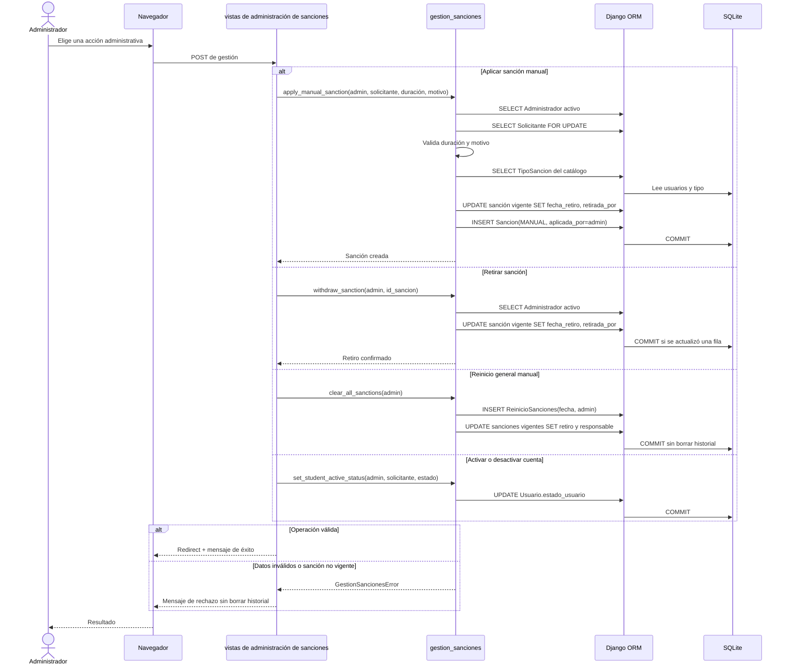

---

## 19. Historia RES-HU-10

Como Administrador, quiero crear salas, asignar horarios válidos y retirar asignaciones sin borrar su historial, de modo que la disponibilidad pueda adaptarse de forma segura.

- Requisitos relacionados: RES-RF-08, RES-RF-11 y RES-RF-13.

---

## 20. Caso de uso RES-CU-10 — Gestionar salas y horarios

- **Objetivo:** registrar una sala, asignarle un horario válido o retirar una asignación sin borrar reservas ni historial.
- **Actor principal:** Administrador.
- **Disparador:** el Administrador selecciona crear sala, crear horario o retirar horario.
- **Precondiciones:** Administrador activo; para crear horario, sala activa existente.
- **Poscondición de éxito:** se crea `Sala`, se crea o reactiva `SalaHorario`, o la asignación pasa a `RETIRADO`.
- **Garantía ante rechazo:** no se crean duplicados ni se retiran horarios en mantenimiento o con reservas activas.

### Flujo principal

1. La vista identifica si la acción es crear sala, crear horario o retirar horario.
2. `create_room()` normaliza el nombre, verifica duplicados y crea una sala activa.
3. `create_room_schedule()` valida formato, orden y duración mínima de 120 minutos.
4. Bloquea la sala durante la transacción y consulta sus horarios actuales.
5. Valida duplicados, superposición y separación mínima de 15 minutos.
6. Reutiliza o crea `Horario`; crea `SalaHorario` o reactiva una asignación previamente `RETIRADO` como `DISPONIBLE`.
7. Para retirar, `remove_room_schedule()` comprueba que la asignación no esté en mantenimiento ni tenga reservas activas y cambia su estado a `RETIRADO`, sin eliminarla.

### Flujos alternativos y excepciones

- **A1 — Nombre duplicado:** se rechaza incluso con diferencias de mayúsculas o espacios.
- **A2 — Duración menor a 120 minutos:** se rechaza.
- **A3 — Superposición o separación menor a 15 minutos:** se rechaza sin cambiar horarios existentes.
- **A4 — Horario en mantenimiento:** primero debe retirarse el mantenimiento.
- **A5 — Reservas activas:** deben modificarse o cancelarse antes de retirar la asignación.

### Diagrama de secuencia de bajo nivel — RES-CU-10

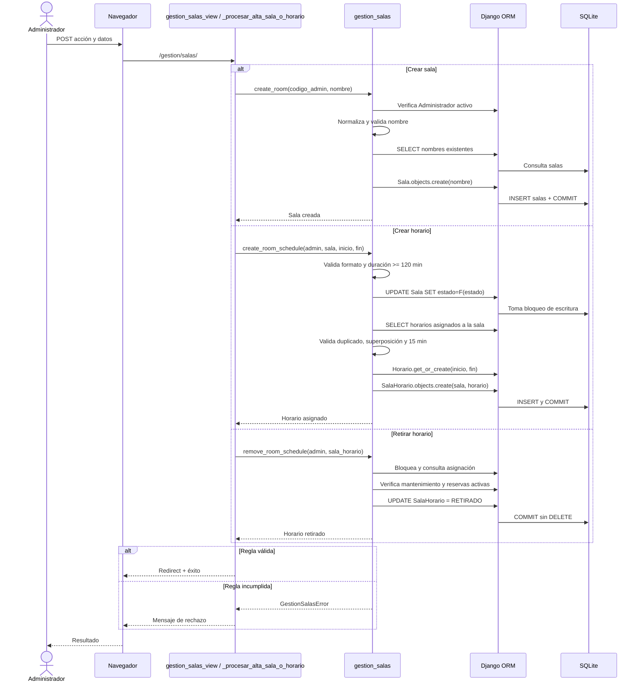

---

## 21. Historia RES-HU-11

Como persona precargada como Solicitante, quiero crear mi cuenta confirmando mi contraseña, de modo que pueda acceder con las credenciales asociadas a mi código institucional.

- Requisito de soporte: gestión de cuentas necesaria para acceder a los casos de uso autenticados; fuera del flujo principal de la Sesión 06.

---

## 22. Caso de uso RES-CU-11 — Crear cuenta de Solicitante

- **Objetivo:** activar credenciales para una fila de Solicitante previamente cargada.
- **Actor principal:** Solicitante no registrado.
- **Disparador:** envía código, correo, contraseña y confirmación.
- **Precondiciones:** código precargado, usuario activo, rol Solicitante y cuenta todavía sin contraseña.
- **Poscondición de éxito:** `Usuario.password_hash` almacena un hash seguro y el usuario puede iniciar sesión.
- **Garantía ante rechazo:** nunca se almacena una contraseña en texto plano ni se activa una cuenta con datos que no coinciden.

### Flujo principal

1. La vista valida formato del código y correo.
2. Comprueba que contraseña y confirmación coincidan y ejecuta los validadores de Django.
3. `register_student_account()` recupera la fila precargada y valida estado, rol y correspondencia del correo.
4. Ejecuta un `UPDATE` condicional solo si `password_hash` sigue vacío.
5. Guarda `make_password(password)` y redirige al inicio de sesión.

### Flujos alternativos y excepciones

- **A1 — Contraseñas diferentes:** la vista rechaza antes de llamar al servicio.
- **A2 — Código o correo no coincidente:** el servicio rechaza sin revelar información adicional.
- **A3 — Cuenta ya registrada:** el `UPDATE` condicional afecta cero filas y se rechaza.

### Diagrama de secuencia de bajo nivel — RES-CU-11

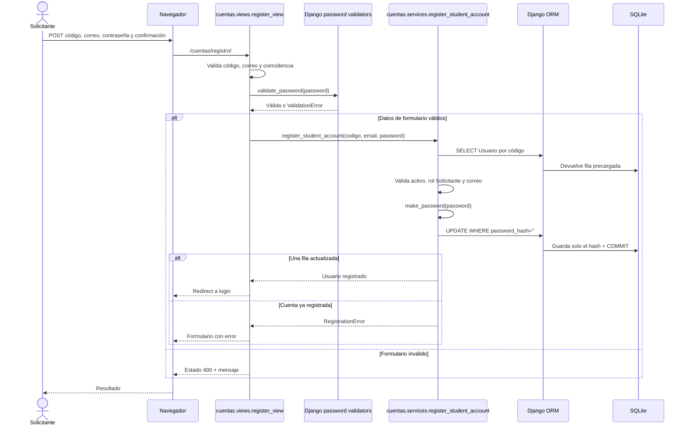

---

## 23. Historia RES-HU-12

Como usuario registrado, quiero iniciar sesión con mi código institucional y contraseña, de modo que el sistema me dirija a las funciones autorizadas para mi rol.

- Requisito de soporte: autenticación necesaria para los casos de uso protegidos.

---

## 24. Caso de uso RES-CU-12 — Iniciar sesión

- **Objetivo:** autenticar una cuenta activa y crear una sesión que identifique al usuario y su rol.
- **Actor principal:** Solicitante, Operante o Administrador.
- **Disparador:** el usuario envía código y contraseña.
- **Precondiciones:** cuenta registrada y activa con uno de los tres roles permitidos.
- **Poscondición de éxito:** la sesión guarda `codigo_usuario` y `nombre_completo`; el panel redirige según el rol.
- **Garantía ante rechazo:** no se crea sesión y se muestra un mensaje genérico.

### Flujo principal

1. La vista recibe código y contraseña.
2. `authenticate_user()` valida el formato numérico del código.
3. Consulta el usuario y verifica que esté activo y tenga contraseña.
4. `check_password()` compara la contraseña con el hash almacenado.
5. Verifica que el rol pertenezca al catálogo permitido.
6. La vista limpia cualquier sesión anterior y guarda el identificador y nombre.
7. `dashboard_view()` dirige al panel de Solicitante, Operante o Administrador.

### Flujos alternativos y excepciones

- **A1 — Credenciales incorrectas, usuario inactivo o rol inválido:** devuelve un único mensaje genérico.
- **A2 — Base de datos no disponible:** renderiza la vista de error con estado 503.

### Diagrama de secuencia de bajo nivel — RES-CU-12

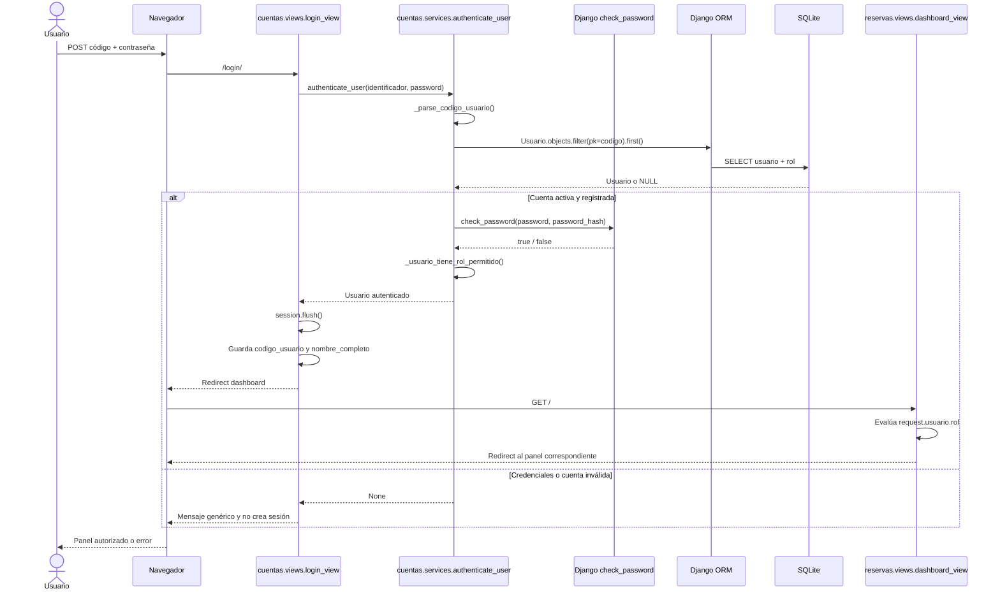

---

## Matriz de trazabilidad resumida

| Historia | Caso de uso | Requisitos principales |
|---|---|---|
| RES-HU-01 | RES-CU-01 Crear reserva propia | RES-RF-04, 06, 08, 09, 12, 16 |
| RES-HU-02 | RES-CU-02 Modificar reserva propia | RES-RF-01, 10, 16 |
| RES-HU-03 | RES-CU-03 Cancelar reserva propia | RES-RF-02, 15, 23, 24 |
| RES-HU-04 | RES-CU-04A Crear reserva asistida | RES-RF-05, 06, 08, 09, 12, 18 |
| RES-HU-04 | RES-CU-04B Modificar reserva asistida | RES-RF-01, 10, 18, 22 |
| RES-HU-04 | RES-CU-04C Cancelar reserva asistida | RES-RF-18, 19, 22 |
| RES-HU-04 | RES-CU-04D Gestionar mantenimiento | RES-RF-03, 17, 18, 21, 22 |
| RES-HU-05 | RES-CU-05 Consultar disponibilidad y avisos | RES-RF-04, 07, 11, 22 |
| RES-HU-06 | RES-CU-06 Modificación administrativa | RES-RF-01, 08, 10, 13, 22 |
| RES-HU-07 | RES-CU-07 Mantenimiento administrativo | RES-RF-03, 13, 17, 21, 22 |
| RES-HU-08 | RES-CU-08 Cancelación administrativa | RES-RF-13, 20, 22 |
| RES-HU-09 | RES-CU-09 Gestionar sanciones y cuentas | RES-RF-13, 14, 15, 23 |
| RES-HU-10 | RES-CU-10 Gestionar salas y horarios | RES-RF-08, 11, 13 |
| RES-HU-11 | RES-CU-11 Crear cuenta | Soporte de autenticación |
| RES-HU-12 | RES-CU-12 Iniciar sesión | Soporte de autenticación |

---

## Casos descartados de la versión anterior

- **Reinicio automático por cambio de semestre:** no es un caso de uso ni crea `ReinicioSanciones`; el conteo se calcula por fecha. El reinicio general manual del Administrador sí está incluido en RES-CU-09 y deja registro.
- **Gestionar roles:** no existe un flujo funcional de interfaz dentro del alcance definido; cada usuario tiene un único rol persistido.
- **Registrar uso presencial:** no está respaldado por los requisitos corregidos ni por un flujo implementado.
- **Enviar correos por mantenimiento:** fue reemplazado por notificaciones internas persistentes.

---

## Participación y asistencia utilizada

- Luciana Soza: revisión de actores, permisos y flujos de mantenimiento.
- Sebastian Cruz: reglas de sanción, cancelación y trazabilidad.
- Sebastian Soto: criterios, excepciones y diagramas de secuencia.
- Asistencia de IA: apoyo para contrastar requisitos, casos de uso, servicios Django y persistencia ORM, manteniendo la validación final a cargo del equipo.
