# Sesión 7 — Historias y casos de uso

- Proyecto: SalaMandra — Reserva de Salas de Estudio
- Integrantes: Luciana Soza (@luci-solar34), Sebastian Cruz (@Sebas0032), Sebastian Soto (@sebas-sst)
- Requisitos de origen: [Sesión 6](sesion-06-requisitos.md)
- IDs incluidos: RES-HU-01 a RES-HU-12 y RES-CU-01 a RES-CU-12

---

## Roles del sistema

El sistema tiene tres roles. Una misma persona puede tener más de un rol a la vez (por ejemplo, Solicitante y Administrador). Los roles se guardan y gestionan en la base de datos propia del sistema; la base de datos de la universidad solo aporta los datos personales (código universitario, nombre, apellido, carrera, etc.).

Para usar el sistema, cada persona primero crea su cuenta (RES-CU-11) y luego inicia sesión (RES-CU-12). Todos los demás casos de uso suponen que el usuario ya inició sesión.

| Rol | Quién lo tiene | Qué puede hacer |
|---|---|---|
| **Solicitante** | Todos los usuarios de la universidad (estudiantes, docentes, administrativos) | Crear, modificar y cancelar sus reservas. Consultar la disponibilidad. |
| **Operador** | Becarios | Crear y cancelar reservas. Consultar la disponibilidad. No puede modificar reservas. |
| **Administrador** | Personal autorizado | Crear, modificar y cancelar reservas (también puede reservar salas). Bloquear horarios de salas por mantenimiento (el bloqueo es definitivo), crear horarios, penalizar solicitantes libremente, registrar el uso presencial, gestionar roles y reiniciar las sanciones del semestre. |

### Permisos por caso de uso

| Caso de uso | Solicitante | Operador | Administrador |
|---|---|---|---|
| RES-CU-01 Crear reserva | Sí | Sí | Sí |
| RES-CU-02 Bloquear horario por mantenimiento | No | No | Sí |
| RES-CU-03 Modificar reserva | Sí | No | Sí |
| RES-CU-04 Cancelar reserva | Sí | Sí | Sí |
| RES-CU-05 Aplicar sanción manual | No | No | Sí |
| RES-CU-06 Consultar disponibilidad | Sí | Sí | Sí |
| RES-CU-07 Reiniciar sanciones del semestre | No | No | Sí |
| RES-CU-08 Gestionar roles | No | No | Sí |
| RES-CU-09 Registrar uso presencial | No | No | Sí |
| RES-CU-10 Crear horarios | No | No | Sí |
| RES-CU-11 Crear cuenta | Sí | Sí | Sí |
| RES-CU-12 Iniciar sesión | Sí | Sí | Sí |

---

## Reglas generales del negocio

1. **Bloques de horario fijos:** se mantienen los bloques (A, B, C, D, E, F), tal cual los horarios de clases de la universidad.
2. **Intervalo de limpieza:** entre una reserva y la siguiente en la misma sala debe haber 15 minutos de desalojo y limpieza.
3. **Base de datos de la universidad y cuenta de usuario:** la universidad solo da acceso a su base de datos externa cada cierto tiempo (por ejemplo, una vez al mes). Cada vez que se recibe ese acceso, se hace una copia de los datos de los usuarios (código universitario, nombre, apellido, carrera y otros datos personales) y se importa a la base de datos propia del sistema. Toda verificación de códigos universitarios se hace contra esa copia local, nunca contra la base externa. Solo se puede crear una cuenta si el código universitario está registrado en la copia local. Los roles (Solicitante, Operador o Administrador) no vienen de la universidad: se guardan y gestionan en la base de datos propia del sistema (RES-CU-08). Al crear la cuenta se asigna el rol Solicitante por defecto y el usuario no elige su rol. La importación periódica solo actualiza los datos personales y no modifica los roles ya asignados. Al crear la cuenta se pide el correo electrónico, que se usa para enviar los avisos cuando se bloquea una sala por mantenimiento, y una contraseña. Para iniciar sesión se usan el código universitario y esa contraseña.
4. **Datos del solicitante:** al reservar, se autocompletan a partir del código institucional. El código se valida en cada reserva contra la copia local más reciente de la base de datos de la universidad. Los estudiantes que se incorporen a mitad del módulo podrán usar el sistema recién cuando se importe la siguiente copia.
5. **Sin reservas continuas:** un solicitante no puede reservar dos bloques consecutivos. Sí puede reservar bloques separados (por ejemplo A-C, A-D o C-E).
6. **Días no habilitados:** no se reserva sábados, domingos ni feriados.
7. **Apertura de reservas:** las reservas de un día se abren a las 00:00 de ese mismo día.
8. **Estados de sala y horario:** HABILITADO, RESERVADA, EN_USO y MANTENIMIENTO.
9. **Vigencia en pantalla:** cuando termina un bloque, deja de mostrarse. Por ejemplo, si una reserva termina a las 12:00, a partir de las 12:00 ya no aparece y se muestra desde el siguiente horario.
10. **Tipo de actividad:** al reservar, el solicitante elige de una lista (por ejemplo tutoría, examen, tarea, proyecto).
11. **Modificación:** una reserva solo se puede modificar antes de que empiece su horario. La reserva original no se libera hasta que el cambio queda confirmado.
12. **Sanciones escalares:** cancelar con menos de 1 hora de anticipación genera una falta. 1ª falta, bloqueo de 24 horas; 2ª, 48 horas; 3ª, 1 semana; 4ª, todo el semestre. El historial se reinicia al inicio de cada semestre.
13. **Solicitante sancionado:** puede ver las salas, pero no puede reservar.
14. **Notificaciones:** cuando el Administrador bloquea un horario por mantenimiento, el sistema envía un correo electrónico a quien lo había reservado, al correo registrado en su cuenta.
15. **Bloqueo por mantenimiento definitivo:** cuando el Administrador bloquea un horario de una sala por mantenimiento, ese horario queda bloqueado en definitiva. El sistema no tiene una opción para desbloquearlo.
16. **Concurrencia (dos solicitudes para el mismo bloque):**
    - Una sala, en un bloque y una fecha, solo puede tener una reserva activa (CONFIRMADA o EN_USO). La base de datos lo garantiza con una restricción única, de modo que nunca se confirman dos reservas activas para el mismo bloque.
    - Si dos solicitudes llegan a la vez, se confirma la primera que la base de datos registra y la segunda se rechaza.
    - No se decide por la hora en que cada usuario presionó el botón, sino por el orden en que la base de datos registra las solicitudes. Por eso no hay empate, ni siquiera si llegan en el mismo milisegundo: una se confirma y la otra falla.
    - La solicitud rechazada no crea ni cambia nada, no genera sanción y muestra el mensaje: "El bloque ya fue reservado por otro usuario. Elige otro horario disponible."
    - La misma regla se aplica al modificar una reserva hacia un bloque nuevo.

---

## 1. Historia RES-HU-01

Como Solicitante, quiero reservar una sala de estudio en un bloque horario habilitado ingresando mi código institucional, de modo que tenga un espacio asegurado para estudiar sin conflictos con otras reservas.

- Requisitos relacionados: RES-RF-04, RES-RF-06, RES-RF-08

---

## 2. Caso de uso RES-CU-01 — Crear reserva de sala de estudio

- **Objetivo:** permitir que un usuario reserve una sala en un bloque horario habilitado, previa validación de su código institucional y respetando las reglas de tiempo y de sanciones.
- **Actor principal:** Solicitante.
- **Roles autorizados:** Solicitante, Operador y Administrador. El Operador reserva en nombre de un solicitante; el Administrador también puede reservar salas.
- **Disparador:** el usuario necesita un espacio de estudio y accede al sistema.
- **Precondiciones:**
  - El bloque horario de la sala está en estado HABILITADO.
  - El usuario tiene una cuenta en la plataforma, creada con su código universitario (registrado en la copia local de la base de datos de la universidad), su correo electrónico y su contraseña.
- **Poscondición de éxito:** el sistema registra la reserva con estado CONFIRMADA, el bloque pasa a RESERVADA, se asigna un identificador único y se autocompletan los datos del solicitante.
- **Garantía ante rechazo:** no se crea la reserva, el bloque conserva su estado y se informa al usuario el motivo exacto del rechazo.

### Flujo principal

1. El usuario ingresa el código institucional, selecciona la sala, la fecha, el bloque horario y el tipo de actividad de una lista de opciones.
2. El sistema valida que el código exista en la copia local de la base de datos de la universidad y autocompleta el nombre y apellido del solicitante.
3. El sistema verifica que el solicitante no tenga una sanción activa.
4. El sistema verifica que la fecha no sea sábado, domingo ni feriado.
5. El sistema verifica que las reservas de ese día estén abiertas (desde las 00:00 del mismo día) y que el bloque no haya terminado.
6. El sistema verifica que el bloque de la sala esté en estado HABILITADO.
7. El sistema valida que el solicitante no tenga una reserva en un bloque consecutivo al elegido ni en el mismo bloque.
8. El sistema verifica que hayan pasado al menos 15 minutos desde el fin de la reserva anterior en esa sala.
9. El sistema registra la reserva con estado CONFIRMADA en una sola operación atómica, cambia el bloque a RESERVADA y devuelve el ID de confirmación.

### E1 — Rechazo: código institucional no existe, paso 2

- **Ocurre en el paso:** 2 (validación del código).
- **Condición:** el código no corresponde a ningún usuario registrado.
- **Respuesta del sistema:**
  - Rechaza la solicitud.
  - Informa que el código no existe.
- **Estado final y datos que se conservan:**
  - No se crea la reserva.
- **El caso termina sin hacer cambios.**

### E2 — Rechazo: solicitante sancionado, paso 3

- **Ocurre en el paso:** 3 (verificación de sanciones).
- **Condición:** el solicitante tiene una sanción activa.
- **Respuesta del sistema:**
  - Rechaza la solicitud.
  - Informa el motivo y el tiempo restante de la sanción (RES-RC-01).
- **Estado final y datos que se conservan:**
  - No se crea la reserva.
  - El solicitante puede seguir viendo las salas, pero no reservarlas.
- **El caso termina sin hacer cambios.**

### E3 — Rechazo: fecha o momento no habilitado, pasos 4 y 5

- **Ocurre en el paso:** 4 o 5 (validación de fecha y horario).
- **Condición:** la fecha es sábado, domingo o feriado; las reservas de ese día aún no están abiertas; o el bloque ya terminó.
- **Respuesta del sistema:**
  - Rechaza la solicitud.
  - Informa el motivo exacto.
- **Estado final y datos que se conservan:**
  - No se crea la reserva.
- **El caso termina sin hacer cambios.**

### E4 — Rechazo: bloque no habilitado, paso 6

- **Ocurre en el paso:** 6 (verificación del estado del bloque).
- **Condición:** el bloque está en estado RESERVADA, EN_USO o MANTENIMIENTO.
- **Respuesta del sistema:**
  - Rechaza la solicitud.
  - Informa el estado del bloque (por ejemplo, que está en mantenimiento).
- **Estado final y datos que se conservan:**
  - No se crea la reserva.
  - El estado del bloque no cambia.
- **El caso termina sin hacer cambios.**

### E5 — Rechazo: bloques consecutivos o doble reserva, paso 7

- **Ocurre en el paso:** 7 (validación de reservas del solicitante).
- **Condición:** el usuario ya tiene una reserva en el mismo bloque o en uno consecutivo (por ejemplo, tiene A e intenta reservar B).
- **Respuesta del sistema:**
  - Rechaza la solicitud (`StudentAlreadyBookedError`).
- **Estado final y datos que se conservan:**
  - Se conservan las reservas previas del solicitante sin cambios.
- **El caso termina sin hacer cambios.**

### E6 — Rechazo: no se cumple el intervalo de 15 minutos, paso 8

- **Ocurre en el paso:** 8 (verificación del intervalo de limpieza).
- **Condición:** no pasaron 15 minutos desde el fin de la reserva anterior en esa sala.
- **Respuesta del sistema:**
  - Rechaza la solicitud.
  - Informa que la sala está en intervalo de desalojo y limpieza.
- **Estado final y datos que se conservan:**
  - No se crea la reserva.
- **El caso termina sin hacer cambios.**

### E7 — Rechazo: el bloque fue reservado al mismo tiempo por otro usuario, paso 9

- **Ocurre en el paso:** 9 (registro atómico).
- **Condición:** dos usuarios intentan reservar el mismo bloque a la vez y la base de datos registró primero la otra solicitud (incluso si llegaron en el mismo milisegundo).
- **Respuesta del sistema:**
  - Rechaza la segunda solicitud.
  - Informa: "El bloque ya fue reservado por otro usuario. Elige otro horario disponible."
- **Estado final y datos que se conservan:**
  - Se conserva la reserva que se registró primero.
  - No se genera ninguna sanción al usuario rechazado.
- **El caso termina sin hacer cambios para el usuario rechazado.**

### Diagrama de flujo — RES-CU-01

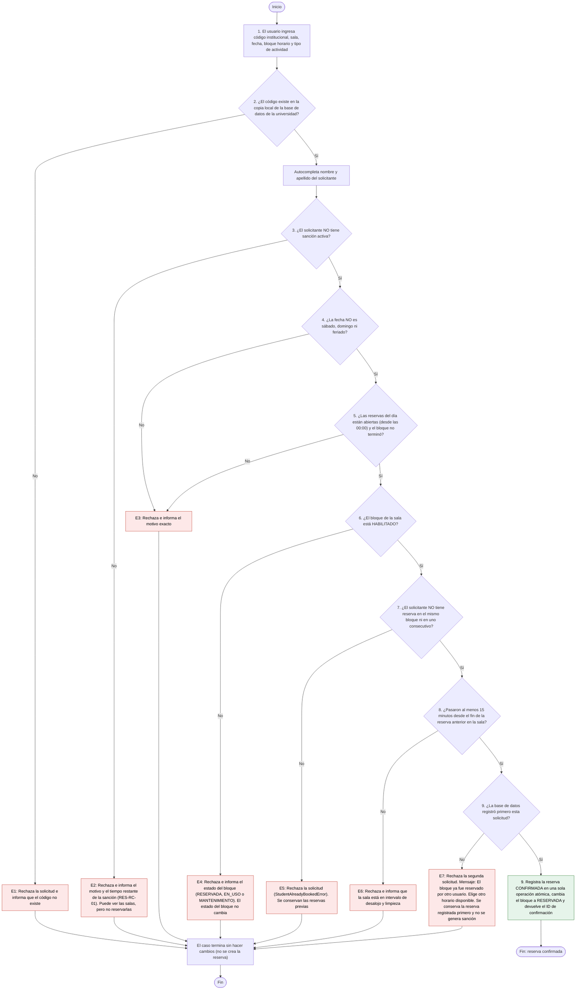

---

## 3. Historia RES-HU-02

Como Administrador, quiero bloquear de forma definitiva un horario específico de una sala cuando hay una falla o imprevisto, aunque esté reservado o los estudiantes ya estén dentro, de modo que el sistema cambie automáticamente las reservas asociadas a ese horario, sin penalizar al estudiante, y le avise por correo electrónico a quien reservó.

- Requisitos relacionados: RES-RF-03, RES-RF-13

---

## 4. Caso de uso RES-CU-02 — Bloquear un horario de una sala por mantenimiento

- **Objetivo:** permitir que un Administrador bloquee de forma definitiva el horario de una sala ante un imprevisto, cambiando automáticamente las reservas asociadas sin penalizar a los estudiantes y notificando por correo electrónico a quien reservó.
- **Actor principal:** Administrador.
- **Roles autorizados:** Administrador.
- **Disparador:** el Administrador detecta una falla técnica o un imprevisto en una sala.
- **Precondiciones:**
  - La sala y el horario existen en el sistema.
  - El usuario tiene rol de Administrador.
  - El bloqueo es posible aunque el horario esté reservado o los estudiantes ya estén dentro de la sala.
- **Poscondición de éxito:** solo el horario seleccionado pasa a estado MANTENIMIENTO. Las reservas CONFIRMADAS o EN_USO de ese horario pasan a POR_MANTENIMIENTO sin penalización. Se registra el motivo, la fecha, la hora y el Administrador, y se envía un correo electrónico a quien reservó. Los demás horarios de la sala no cambian. El bloqueo es definitivo: el sistema no ofrece una opción para desbloquear el horario.
- **Garantía ante rechazo:** el horario mantiene su estado anterior, no se modifica ninguna reserva y se informa al Administrador por qué no fue posible el bloqueo.

### Flujo principal

1. El Administrador selecciona la sala y el horario que desea bloquear y escribe el motivo.
2. El sistema valida que el usuario tenga permisos de Administrador y que la sala y el horario existan.
3. El sistema verifica que el horario seleccionado no esté ya en estado MANTENIMIENTO.
4. El sistema busca las reservas CONFIRMADAS o EN_USO asociadas al horario seleccionado.
5. Para cada reserva encontrada, el sistema cambia su estado a POR_MANTENIMIENTO sin registrar penalización.
6. El sistema cambia el estado del horario seleccionado a MANTENIMIENTO, sin tocar los demás horarios de la sala.
7. El sistema registra el motivo del bloqueo (por ejemplo, "No hay electricidad"), la fecha, la hora y el Administrador responsable.
8. El sistema envía un correo electrónico, al correo registrado en su cuenta, a cada usuario que había reservado ese horario, indicando la sala, el horario y el motivo.
9. El sistema confirma el bloqueo y lista las reservas afectadas.

### E1 — Rechazo: usuario sin permisos de Administrador, paso 2

- **Ocurre en el paso:** 2 (validación de permisos).
- **Condición:** el usuario que solicita bloquear no tiene rol de Administrador.
- **Respuesta del sistema:**
  - Rechaza la solicitud (`NotAuthorizedError`).
  - Informa: "No tienes permisos para bloquear salas. Contacta al administrador."
- **Estado final y datos que se conservan:**
  - El horario sigue con su estado anterior.
  - Ninguna reserva se modifica y no se envía ningún correo.
- **El caso termina sin hacer cambios.**

### E2 — Rechazo: sala u horario no existe, paso 2

- **Ocurre en el paso:** 2 (validación de existencia).
- **Condición:** el ID de la sala o del horario no corresponde a ningún registro en el sistema.
- **Respuesta del sistema:**
  - Rechaza la solicitud (`ScheduleNotFoundError`).
  - Informa: "La sala [ID] no existe en el sistema."
- **Estado final y datos que se conservan:**
  - No hay cambios en el sistema.
- **El caso termina sin hacer cambios.**

### E3 — Rechazo: horario ya bloqueado, paso 3

- **Ocurre en el paso:** 3 (verificación del estado del horario).
- **Condición:** el horario seleccionado ya está en estado MANTENIMIENTO.
- **Respuesta del sistema:**
  - Rechaza la solicitud (`ScheduleAlreadyBlockedError`).
  - Informa que el horario ya está en mantenimiento.
- **Estado final y datos que se conservan:**
  - No se duplica el registro del bloqueo.
  - Las reservas y el estado del horario no cambian.
- **El caso termina sin hacer cambios.**

### Diagrama de flujo — RES-CU-02

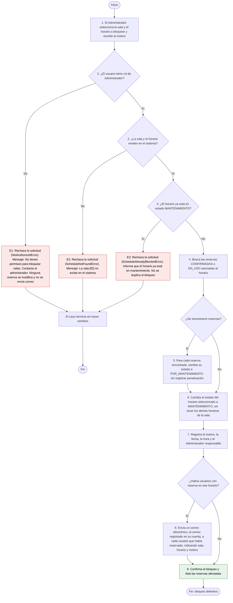

---

## 5. Historia RES-HU-03

Como Solicitante, quiero cambiar la sala o el horario de mi reserva antes de que empiece, de modo que pueda reprogramarla sin perder mi reserva original si me arrepiento o el cambio no es posible.

- Requisitos relacionados: RES-RF-01, RES-RF-10

---

## 6. Caso de uso RES-CU-03 — Modificar una reserva existente

- **Objetivo:** permitir que un usuario cambie la sala o el horario de una reserva antes de que empiece, sin perder la reserva original hasta que el cambio quede confirmado.
- **Actor principal:** Solicitante.
- **Roles autorizados:** Solicitante y Administrador. El Operador no puede modificar reservas.
- **Disparador:** el usuario necesita reprogramar su horario o cambiar de sala.
- **Precondiciones:**
  - Existe una reserva en estado CONFIRMADA.
  - La reserva no ha comenzado.
- **Poscondición de éxito:** la reserva queda en la nueva sala u horario con estado CONFIRMADA, el nuevo bloque pasa a RESERVADA y el bloque original vuelve a HABILITADO.
- **Garantía ante rechazo:** si el cambio no se confirma, la reserva original se conserva intacta (RES-RF-10).

### Flujo principal

1. El usuario selecciona su reserva y solicita cambiar de sala o de horario.
2. El sistema comprueba que la reserva original todavía no haya comenzado.
3. El sistema valida que el nuevo bloque y sala estén HABILITADOS, que el día sea hábil y que se cumplan el intervalo de 15 minutos y la regla de bloques no consecutivos.
4. El usuario confirma la modificación.
5. El sistema registra la nueva reserva y, recién en ese momento, libera la original, todo en una sola operación.
6. El sistema confirma el cambio al usuario.

### E1 — Rechazo: la reserva ya comenzó, paso 2

- **Ocurre en el paso:** 2 (validación de inicio de la reserva).
- **Condición:** el horario de la reserva ya comenzó.
- **Respuesta del sistema:**
  - Rechaza el cambio con una excepción explícita.
- **Estado final y datos que se conservan:**
  - La reserva original se mantiene confirmada, sin cambios.
- **El caso termina sin hacer cambios.**

### E2 — Rechazo: conflicto en el nuevo horario, pasos 3 y 5

- **Ocurre en el paso:** 3 o 5 (validación del nuevo bloque).
- **Condición:** el nuevo bloque está reservado, en uso, en mantenimiento, incumple una regla de tiempo, o otro usuario lo reservó antes según el orden de la base de datos (regla de concurrencia).
- **Respuesta del sistema:**
  - Rechaza la modificación.
  - Informa el motivo del conflicto.
- **Estado final y datos que se conservan:**
  - Se conserva la reserva original.
- **El caso termina sin hacer cambios.**

### E3 — El usuario se arrepiente antes de confirmar, paso 4

- **Ocurre en el paso:** 4 (confirmación del cambio).
- **Condición:** el usuario cancela el proceso de modificación antes de confirmar.
- **Respuesta del sistema:**
  - Descarta el cambio.
- **Estado final y datos que se conservan:**
  - La sala queda con la reserva original, sin sanción.
- **El caso termina sin hacer cambios.**

### Diagrama de flujo — RES-CU-03

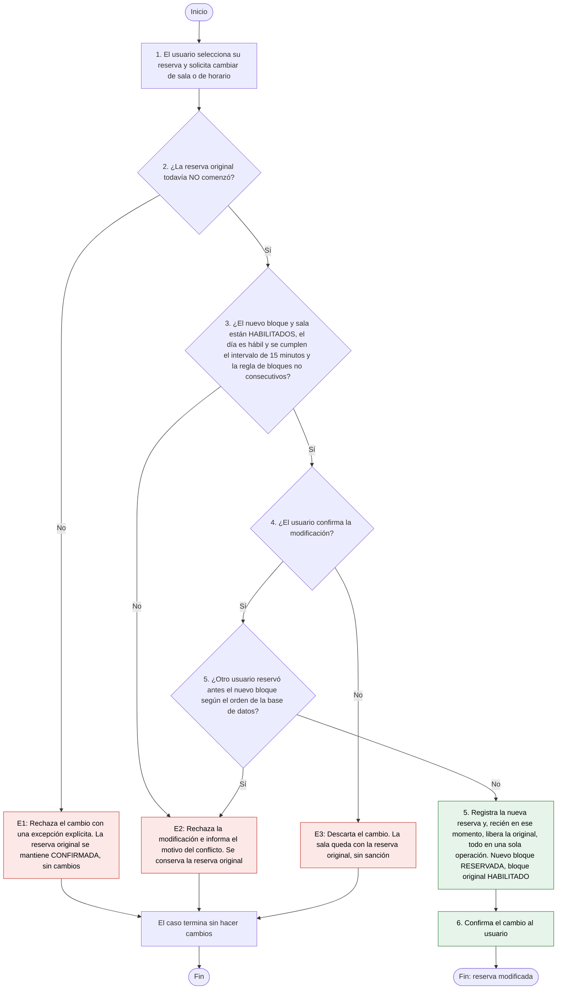

---

## 7. Historia RES-HU-04

Como Solicitante, quiero cancelar mi reserva y saber de inmediato si la cancelación tiene sanción según la anticipación con la que la hago, de modo que la sala quede libre para otros y yo conozca exactamente la consecuencia de mi cancelación.

- Requisitos relacionados: RES-RF-02, RES-RC-01

---

## 8. Caso de uso RES-CU-04 — Cancelar una reserva y gestionar sanciones automáticas

- **Objetivo:** registrar la cancelación de una reserva y aplicar sanciones escalares automáticas cuando se cancela con menos de 1 hora de anticipación.
- **Actor principal:** Solicitante.
- **Roles autorizados:** Solicitante, Operador y Administrador. Si cancela un Operador o un Administrador, la falta se registra al titular de la reserva.
- **Disparador:** el usuario solicita cancelar una reserva.
- **Precondiciones:**
  - Existe una reserva asociada en estado CONFIRMADA.
- **Poscondición de éxito:** la reserva pasa a CANCELADA y el bloque vuelve a HABILITADO. Si la cancelación fue tardía, además se suma una falta y se aplica el bloqueo temporal correspondiente.

### Flujo principal

1. El usuario selecciona la reserva confirmada y presiona "Cancelar reserva".
2. El sistema calcula la diferencia entre la hora actual y la hora de inicio del bloque.
3. El sistema verifica que falten 60 minutos o más.
4. El sistema marca la reserva como CANCELADA, libera la sala y confirma la cancelación sin penalización.

### E1 — Sanción: cancelación tardía (menos de 1 hora), paso 3

- **Ocurre en el paso:** 3 (verificación de anticipación).
- **Condición:** faltan menos de 60 minutos para el inicio del bloque.
- **Respuesta del sistema:**
  - Cambia la reserva a CANCELADA y libera el bloque.
  - Registra una falta en el historial del titular de la reserva.
  - Aplica el bloqueo según la escala semestral: 1ª falta, 24 horas; 2ª falta, 48 horas; 3ª falta, 1 semana; 4ª falta, todo el semestre.
  - Muestra un mensaje con la vigencia exacta de la sanción (RES-RC-01).
- **Estado final y datos que se conservan:**
  - Reserva en estado CANCELADA y bloque HABILITADO.
  - Falta registrada y titular bloqueado para nuevas reservas durante el tiempo de la sanción.

### Diagrama de flujo — RES-CU-04

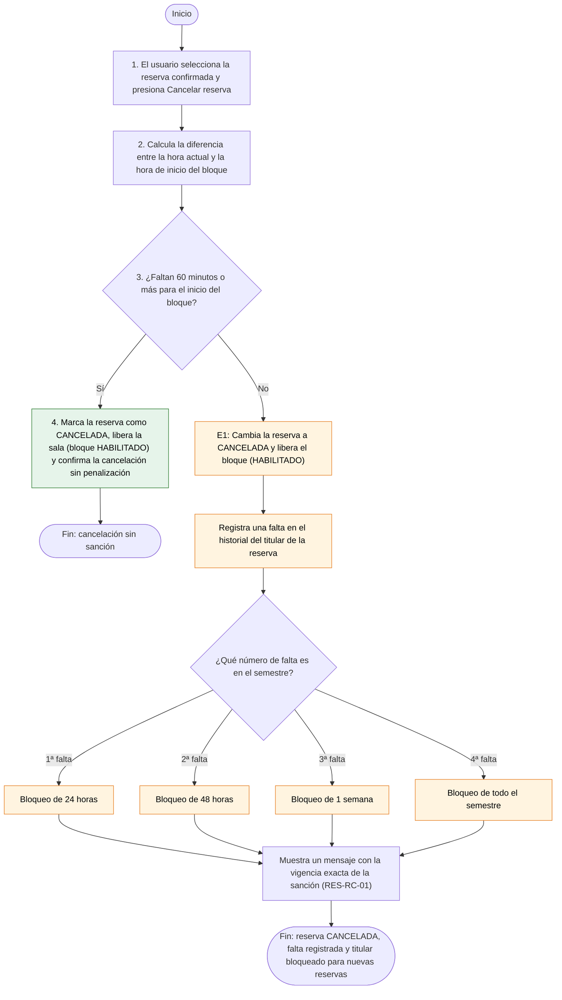

---

## 9. Historia RES-HU-05

Como Administrador, quiero aplicar una sanción manual con un comentario obligatorio a un solicitante que no se presentó en la sala que reservó, de modo que quede registrado el motivo y el solicitante no pueda reservar mientras dure la sanción.

- Requisitos relacionados: RES-RF-14

---

## 10. Caso de uso RES-CU-05 — Aplicar sanción manual a un solicitante

- **Objetivo:** permitir que un Administrador sancione manualmente a un solicitante, con un comentario que explique el motivo.
- **Actor principal:** Administrador.
- **Roles autorizados:** Administrador.
- **Disparador:** el Administrador no encuentra al solicitante dentro de la sala en el horario que reservó, o detecta otra infracción.
- **Precondiciones:**
  - El solicitante está registrado en el sistema.
  - Quien ejecuta la acción tiene rol de Administrador.
- **Poscondición de éxito:** se guarda un registro en `sanciones` con el solicitante, el Administrador responsable, el comentario con el motivo y las fechas de inicio y fin del bloqueo.
- **Garantía ante rechazo:** no se aplica la sanción si falta el comentario o los permisos.

### Flujo principal

1. El Administrador busca al solicitante por su código institucional.
2. El Administrador escribe el comentario con el motivo (obligatorio) y define la duración de la sanción.
3. El sistema valida los permisos de Administrador y que el comentario no esté vacío.
4. El sistema registra la sanción y activa el bloqueo del solicitante.
5. El sistema confirma el registro de la sanción.

### E1 — Rechazo: comentario omitido, paso 3

- **Ocurre en el paso:** 3 (validación del comentario).
- **Condición:** el campo de comentario está vacío.
- **Respuesta del sistema:**
  - Rechaza la acción.
  - Informa: "El motivo es obligatorio para registrar una sanción manual".
- **Estado final y datos que se conservan:**
  - No se registra la sanción.
  - El solicitante no queda bloqueado.
- **El caso termina sin hacer cambios.**

### E2 — Rechazo: sin permisos, paso 3

- **Ocurre en el paso:** 3 (validación de permisos).
- **Condición:** el usuario que ejecuta la acción no tiene rol de Administrador.
- **Respuesta del sistema:**
  - Rechaza la acción (`NotAuthorizedError`).
- **Estado final y datos que se conservan:**
  - No se registra la sanción.
- **El caso termina sin hacer cambios.**

### Diagrama de flujo — RES-CU-05

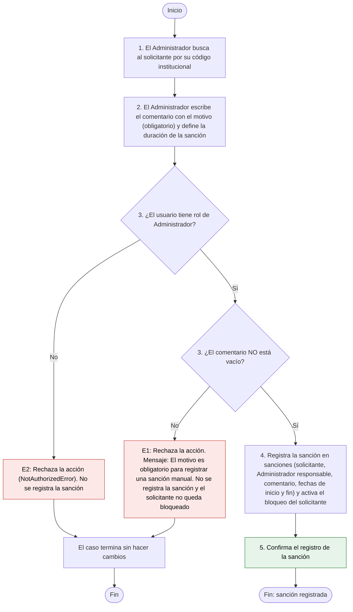

---

## 11. Historia RES-HU-06

Como Solicitante, quiero consultar qué salas y bloques horarios están habilitados, reservados, en uso o en mantenimiento, de modo que pueda elegir un horario antes de reservar, incluso si tengo una sanción vigente.

- Requisitos relacionados: RES-RF-04, RES-RF-07

---

## 12. Caso de uso RES-CU-06 — Consultar disponibilidad de salas y horarios

- **Objetivo:** permitir que cualquier usuario consulte las salas y bloques horarios del día, incluso con una sanción vigente, sin poder reservar si está sancionado.
- **Actor principal:** Solicitante.
- **Roles autorizados:** Solicitante, Operador y Administrador.
- **Disparador:** el usuario entra al módulo de consulta de horarios.
- **Precondiciones:**
  - Ninguna.
- **Poscondición de éxito:** el sistema muestra las salas y los bloques vigentes con su estado (HABILITADO, RESERVADA, EN_USO o MANTENIMIENTO).

### Flujo principal

1. El usuario selecciona la fecha que quiere consultar.
2. El sistema obtiene las salas activas y sus bloques horarios fijos (A, B, C, D, E, F).
3. El sistema determina el estado de cada bloque según las reservas, el uso presencial, los bloqueos por mantenimiento y el intervalo de limpieza de 15 minutos.
4. El sistema oculta los bloques que ya terminaron. Por ejemplo, un bloque que termina a las 12:00 deja de mostrarse desde las 12:00 y se muestra a partir del siguiente.
5. El sistema muestra las salas y bloques con su estado.
6. Si el usuario tiene una sanción activa, el sistema le muestra un aviso: puede ver las salas, pero no reservarlas.

### Diagrama de flujo — RES-CU-06

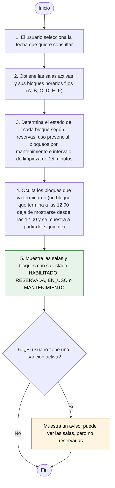

---

## 13. Historia RES-HU-07

Como Administrador, quiero reiniciar el historial de sanciones al inicio de cada semestre, de modo que las faltas empiecen de cero en el nuevo periodo y el historial anterior siga disponible para auditoría.

- Requisitos relacionados: RES-RF-15

---

## 14. Caso de uso RES-CU-07 — Reiniciar historial semestral de sanciones

- **Objetivo:** reiniciar, de forma automática o a demanda, el contador de faltas al inicio de un nuevo semestre, conservando el historial para auditoría.
- **Actor principal:** Administrador.
- **Roles autorizados:** Administrador (o el proceso automático del sistema).
- **Disparador:** inicio oficial del semestre académico.
- **Precondiciones:**
  - El inicio del nuevo semestre está registrado en el sistema.
- **Poscondición de éxito:** el contador de faltas de todos los solicitantes vuelve a cero y las sanciones del semestre anterior quedan archivadas.

### Flujo principal

1. El Administrador ejecuta el cambio de semestre, o el sistema detecta la fecha de inicio.
2. El sistema valida los permisos de Administrador.
3. El sistema archiva las sanciones del semestre anterior.
4. El sistema restablece a cero el contador de faltas de todos los solicitantes.
5. El sistema emite un reporte del cierre semestral y confirma el reinicio.

### Diagrama de flujo — RES-CU-07

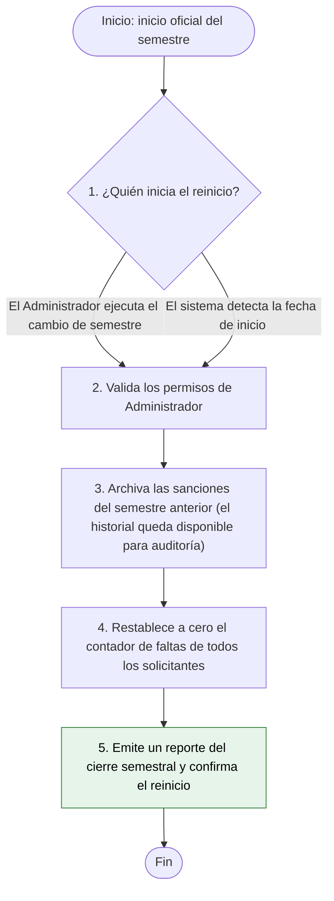

---

## 15. Historia RES-HU-08

Como Administrador, quiero asignar y quitar roles a los usuarios, pudiendo darle más de un rol a la misma persona, de modo que cada usuario tenga solo los permisos que le corresponden.

- Requisitos relacionados: RES-RF-13

---

## 16. Caso de uso RES-CU-08 — Asignar y gestionar roles de usuarios

- **Objetivo:** permitir que un Administrador asigne o quite los roles Solicitante, Operador y Administrador, admitiendo que una persona tenga varios.
- **Actor principal:** Administrador.
- **Roles autorizados:** Administrador.
- **Disparador:** incorporación de becarios o personal, o cambio de privilegios.
- **Precondiciones:**
  - El usuario existe en la tabla `usuarios`.
- **Poscondición de éxito:** se actualizan las relaciones en `usuarios_roles` y los permisos del usuario cambian de inmediato.

### Flujo principal

1. El Administrador busca al usuario por su código o correo institucional.
2. El sistema muestra los datos del usuario y sus roles asignados.
3. El Administrador marca o desmarca los roles deseados (por ejemplo, Solicitante y Administrador al mismo tiempo).
4. El sistema valida que quien ejecuta la acción tenga rol de Administrador.
5. El sistema guarda los roles y actualiza los permisos del usuario.

### Diagrama de flujo — RES-CU-08

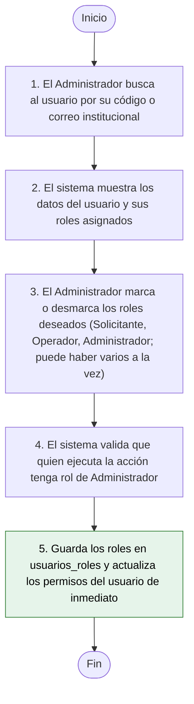

---

## 17. Historia RES-HU-09

Como Administrador, quiero registrar que el solicitante está dentro de la sala a la hora de su reserva, de modo que la reserva pase a EN_USO y, si no se presenta, pueda sancionarlo.

- Requisitos relacionados: RES-RF-11, RES-RF-14

---

## 18. Caso de uso RES-CU-09 — Registrar uso presencial de sala

- **Objetivo:** permitir que el Administrador confirme la presencia del solicitante en la sala reservada, cambiando la reserva y la sala a EN_USO.
- **Actor principal:** Administrador.
- **Roles autorizados:** Administrador.
- **Disparador:** llega la hora de inicio de una reserva y el Administrador verifica la sala.
- **Precondiciones:**
  - Existe una reserva CONFIRMADA para el bloque en curso.
- **Poscondición de éxito:** la reserva pasa a EN_USO y la sala queda formalmente ocupada.

### Flujo principal

1. El Administrador busca la reserva del bloque en curso, por la sala o por el código institucional del solicitante.
2. El sistema muestra la reserva confirmada correspondiente.
3. El sistema valida que la hora actual esté dentro del margen permitido del bloque.
4. El Administrador confirma que el solicitante está dentro de la sala y presiona "Confirmar ingreso".
5. El sistema cambia la reserva a EN_USO y la sala a EN_USO.

### E1 — Solicitante ausente o tiempo agotado, paso 3

- **Ocurre en el paso:** 3 (validación del margen de tiempo) o 4 (confirmación de presencia).
- **Condición:** el Administrador no encuentra al solicitante en la sala, o ya pasó la ventana de tolerancia del bloque.
- **Respuesta del sistema:**
  - La reserva no pasa a EN_USO.
- **Estado final y datos que se conservan:**
  - La reserva conserva su estado anterior.
  - El Administrador puede aplicar una sanción manual por inasistencia (RES-CU-05).

### Diagrama de flujo — RES-CU-09

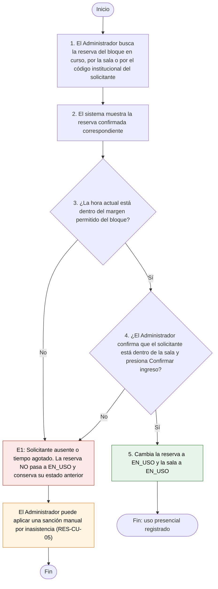

---

## 19. Historia RES-HU-10

Como Administrador, quiero crear los bloques de horario de las salas, de modo que coincidan con los horarios de clases de la universidad y los solicitantes puedan reservarlos.

- Requisitos relacionados: RES-RF-08, RES-RF-13

---

## 20. Caso de uso RES-CU-10 — Crear horarios

- **Objetivo:** permitir que un Administrador cree los bloques de horario fijos, iguales a los horarios de clases de la universidad.
- **Actor principal:** Administrador.
- **Roles autorizados:** Administrador.
- **Disparador:** hay que registrar o actualizar los bloques de horario.
- **Precondiciones:**
  - El usuario tiene rol de Administrador.
- **Poscondición de éxito:** el bloque queda registrado y asociado a las salas activas en estado HABILITADO.
- **Garantía ante rechazo:** no se crea el bloque si faltan permisos o los datos no son válidos.

### Flujo principal

1. El Administrador ingresa el nombre del bloque (por ejemplo, "A"), la hora de inicio y la hora de fin.
2. El sistema valida que el usuario tenga permisos de Administrador.
3. El sistema valida que la hora de fin sea posterior a la de inicio y que el bloque no se cruce con otro existente.
4. El sistema registra el bloque y lo asocia a las salas activas en estado HABILITADO.
5. El sistema confirma la creación del horario.

### E1 — Rechazo: usuario sin permisos de Administrador, paso 2

- **Ocurre en el paso:** 2 (validación de permisos).
- **Condición:** el usuario no tiene rol de Administrador.
- **Respuesta del sistema:**
  - Rechaza la solicitud (`NotAuthorizedError`).
- **Estado final y datos que se conservan:**
  - No se crea ningún bloque.
- **El caso termina sin hacer cambios.**

### E2 — Rechazo: datos del horario no válidos, paso 3

- **Ocurre en el paso:** 3 (validación del horario).
- **Condición:** la hora de fin no es posterior a la de inicio, o el bloque se cruza con otro existente.
- **Respuesta del sistema:**
  - Rechaza la solicitud.
  - Informa cuál es el problema.
- **Estado final y datos que se conservan:**
  - No se crea el bloque.
- **El caso termina sin hacer cambios.**

### Diagrama de flujo — RES-CU-10

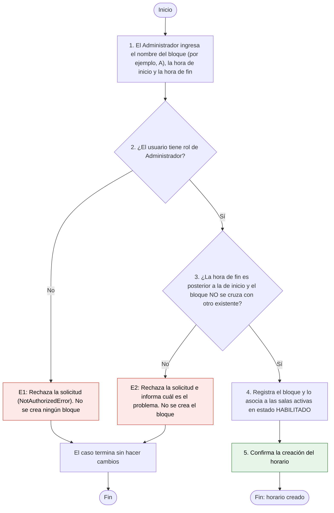

---

## 21. Historia RES-HU-11

Como usuario de la universidad, quiero crear mi cuenta con mi código universitario, mi correo electrónico y una contraseña, de modo que pueda entrar a la plataforma como Solicitante (el rol por defecto) y recibir un correo cuando se bloquee una sala que reservé.

- Requisitos relacionados: RES-RF-06, RES-RF-13

---

## 22. Caso de uso RES-CU-11 — Crear cuenta de usuario

- **Objetivo:** permitir que una persona de la universidad cree su cuenta, validando que su código universitario esté registrado en la copia local de la base de datos de la universidad (importada periódicamente desde la base externa).
- **Actor principal:** usuario de la universidad (estudiante, docente, administrativo o becario).
- **Roles autorizados:** cualquier persona cuyo código universitario esté registrado en la copia local. La cuenta se crea con el rol Solicitante por defecto; el usuario no elige su rol. Los roles Operador y Administrador los asigna después un Administrador (RES-CU-08) en la base de datos del sistema.
- **Disparador:** la persona entra por primera vez a la plataforma y todavía no tiene cuenta.
- **Precondiciones:**
  - El código universitario está registrado en la copia local de la base de datos de la universidad, importada a la base de datos del sistema en la última actualización.
  - Ese código todavía no tiene una cuenta creada.
- **Poscondición de éxito:** la cuenta queda creada y asociada al código universitario, con el rol Solicitante por defecto. El correo electrónico queda registrado para recibir los avisos de mantenimiento y la contraseña queda guardada de forma segura.
- **Garantía ante rechazo:** no se crea la cuenta y se informa al usuario el motivo.

### Flujo principal

1. El usuario ingresa su código universitario, su correo electrónico y la contraseña que quiere usar.
2. El sistema verifica que el código esté registrado en la copia local de la base de datos de la universidad (no consulta la base externa).
3. El sistema verifica que ese código no tenga ya una cuenta creada.
4. El sistema verifica que el correo electrónico tenga un formato válido y no esté asociado a otra cuenta.
5. El sistema obtiene el nombre, el apellido y la carrera asociados a ese código en la copia local.
6. El sistema guarda la contraseña de forma cifrada y crea la cuenta con el correo y el rol Solicitante por defecto.
7. El sistema confirma que la cuenta fue creada y pide iniciar sesión.

### E1 — Rechazo: código no registrado en la copia local de la base de datos, paso 2

- **Ocurre en el paso:** 2 (validación del código).
- **Condición:** el código universitario no está registrado en la copia local de la base de datos de la universidad.
- **Respuesta del sistema:**
  - Rechaza la solicitud.
  - Informa: "El código universitario no está registrado en la base de datos del sistema."
- **Estado final y datos que se conservan:**
  - No se crea la cuenta.
- **El caso termina sin hacer cambios.**

### E2 — Rechazo: el código ya tiene una cuenta, paso 3

- **Ocurre en el paso:** 3 (verificación de cuenta existente).
- **Condición:** ya existe una cuenta creada con ese código universitario.
- **Respuesta del sistema:**
  - Rechaza la solicitud.
  - Informa que ese código ya tiene una cuenta e indica que debe iniciar sesión.
- **Estado final y datos que se conservan:**
  - La cuenta existente no se modifica.
- **El caso termina sin hacer cambios.**

### E3 — Rechazo: correo no válido o ya usado, paso 4

- **Ocurre en el paso:** 4 (validación del correo).
- **Condición:** el correo no tiene un formato válido o ya pertenece a otra cuenta.
- **Respuesta del sistema:**
  - Rechaza la solicitud.
  - Informa cuál es el problema con el correo.
- **Estado final y datos que se conservan:**
  - No se crea la cuenta.
- **El caso termina sin hacer cambios.**

### Diagrama de flujo — RES-CU-11

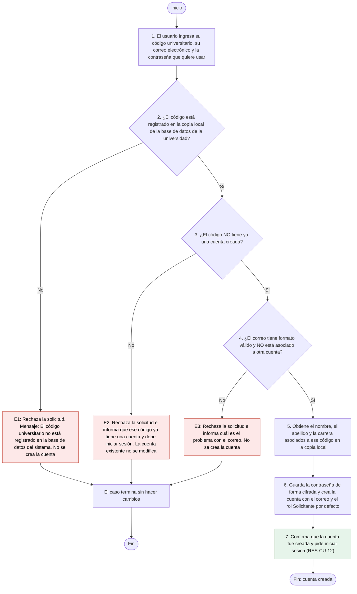

---

## 23. Historia RES-HU-12

Como usuario con cuenta, quiero iniciar sesión con mi código universitario y mi contraseña, de modo que el sistema me muestre solo las funciones que permite mi rol.

- Requisitos relacionados: RES-RF-13

---

## 24. Caso de uso RES-CU-12 — Iniciar sesión

- **Objetivo:** permitir que un usuario con cuenta entre a la plataforma con su código universitario y la contraseña que eligió al crearla.
- **Actor principal:** usuario con cuenta.
- **Roles autorizados:** Solicitante, Operador y Administrador.
- **Disparador:** el usuario quiere usar la plataforma.
- **Precondiciones:**
  - El usuario creó su cuenta (RES-CU-11).
- **Poscondición de éxito:** el usuario queda con la sesión iniciada y el sistema le muestra las funciones que corresponden a su rol.
- **Garantía ante rechazo:** no se inicia la sesión y no se muestra ninguna función del sistema.

### Flujo principal

1. El usuario ingresa su código universitario y su contraseña.
2. El sistema verifica que exista una cuenta con ese código.
3. El sistema verifica que la contraseña coincida con la que se registró al crear la cuenta.
4. El sistema verifica que la cuenta esté activa.
5. El sistema inicia la sesión y muestra las funciones según el rol del usuario.

### E1 — Rechazo: código o contraseña incorrectos, pasos 2 y 3

- **Ocurre en el paso:** 2 o 3 (verificación de credenciales).
- **Condición:** no existe una cuenta con ese código, o la contraseña no coincide.
- **Respuesta del sistema:**
  - Rechaza el ingreso.
  - Informa: "Código o contraseña incorrectos." El mensaje no dice cuál de los dos falló.
- **Estado final y datos que se conservan:**
  - No se inicia sesión.
- **El caso termina sin hacer cambios.**

### E2 — Rechazo: cuenta inactiva, paso 4

- **Ocurre en el paso:** 4 (verificación del estado de la cuenta).
- **Condición:** la cuenta del usuario está inactiva.
- **Respuesta del sistema:**
  - Rechaza el ingreso.
  - Informa que la cuenta está inactiva.
- **Estado final y datos que se conservan:**
  - No se inicia sesión.
- **El caso termina sin hacer cambios.**

### Diagrama de flujo — RES-CU-12

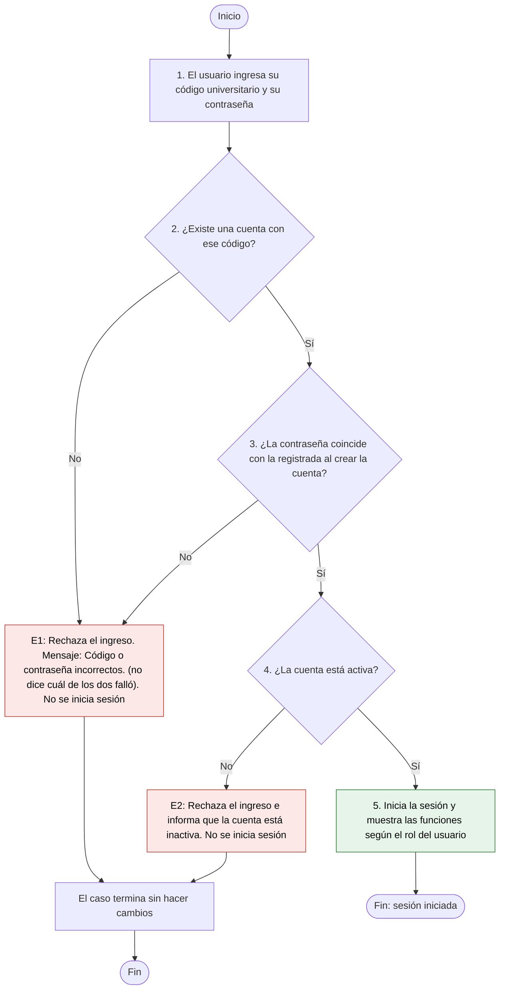

---

## 25. Trazabilidad

| Requisito | Historia | Caso de uso | Regla o criterio clave |
|---|---|---|---|
| RES-RF-01 | RES-HU-03 | RES-CU-03 | Modificación solo antes de que empiece el horario reservado |
| RES-RF-02 | RES-HU-04 | RES-CU-04 | Cancelar con menos de 1 hora aplica la escala de faltas |
| RES-RF-03 | RES-HU-02 | RES-CU-02 | Mantenimiento cambia las reservas a POR_MANTENIMIENTO sin penalizar y avisa por correo |
| RES-RF-04 | RES-HU-01, RES-HU-06 | RES-CU-01, RES-CU-06 | Verificación de sanciones al intentar reservar |
| RES-RF-06 | RES-HU-01, RES-HU-11 | RES-CU-01, RES-CU-11 | Código validado contra la copia local de la base de datos de la universidad al reservar y al crear la cuenta |
| RES-RF-07 | RES-HU-06 | RES-CU-06 | El sancionado puede ver pero no reservar |
| RES-RF-08 | RES-HU-01, RES-HU-10 | RES-CU-01, RES-CU-10 | Bloques fijos, intervalo de 15 minutos y sin bloques consecutivos |
| RES-RF-10 | RES-HU-03 | RES-CU-03 | La reserva original se conserva hasta confirmar el cambio |
| RES-RF-11 | RES-HU-09 | RES-CU-09 | Estados HABILITADO, RESERVADA, EN_USO, MANTENIMIENTO |
| RES-RF-13 | RES-HU-02, RES-HU-08, RES-HU-10, RES-HU-11, RES-HU-12 | RES-CU-02, RES-CU-08, RES-CU-10, RES-CU-11, RES-CU-12 | Permisos por rol, varios roles a la vez, cuenta con código registrado e inicio de sesión |
| RES-RF-14 | RES-HU-05, RES-HU-09 | RES-CU-05, RES-CU-09 | Comentario obligatorio en sanciones manuales |
| RES-RF-15 | RES-HU-07 | RES-CU-07 | Reinicio del historial en cada semestre |

---

