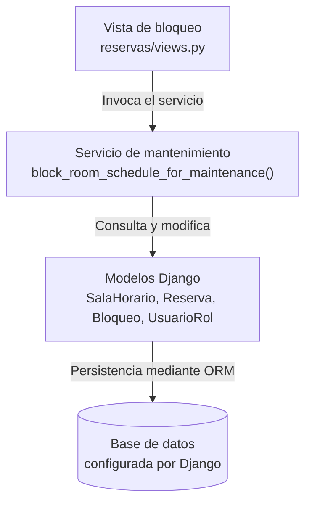

# Sesión 12 — Arquitectura y verificación del flujo

- **Proyecto e integrantes:** SalaMandra — Reserva de Salas de Estudio. Integrantes: Luciana Soza (@luci-solar34), Sebastian Cruz (@Sebas0032) y Sebastian Soto (@sebas-sst).
- **Fecha de la actividad:** 13/10/2026.
- **Requisitos:** [Sesión 6](sesion-06-requisitos.md).
- **Modelos:** [Sesión 7](sesion-07-modelos.md).
- **Plan:** [Sesiones 8–9](sesion-08-09-plan-salamandra_dias.md).
- **Operación seleccionada:** bloqueo de un horario de una sala por mantenimiento (RES-CU-02).
- **Requisitos relacionados:** RES-RF-03, RES-RF-13 y RES-RF-17.
- **Caso de uso relacionado:** RES-CU-02 — Bloqueo por mantenimiento.
- **Issue 29:** Implementar bloqueo de horario de una sala por mantenimiento. Enlace: https://github.com/Sebas0032/SalaMandra/issues/29

## 1. Punto de partida y alcance

### Punto de partida

El proyecto ya contaba con la función `block_room_schedule_for_maintenance()` en `reservas/services.py`, encargada de gestionar el bloqueo de un horario por mantenimiento.

También existía una suite de pruebas generales en `tests/tests_mantenimiento.py`, que verifica distintos comportamientos del bloqueo, como el bloqueo exitoso, la bitácora, el aislamiento entre salas y horarios, los permisos, los horarios inexistentes y el doble bloqueo.

### Problema abordado

Se necesitaba organizar los tres escenarios esenciales de la Sesión 12 en una ubicación específica y automatizar su ejecución mediante GitHub Actions.

### Alcance realizado

- Se creó la carpeta `tests/sesion12/`.
- Se creó el archivo `tests/sesion12/test_flujo_mantenimiento.py`.
- Se incorporaron tres pruebas: bloqueo exitoso, doble bloqueo y usuario sin permisos.
- Se configuró `.github/workflows/ci-sesion12.yml`.
- Se automatizó la ejecución de las pruebas mediante GitHub Actions.
- Se configuró la generación de un reporte JUnit XML como evidencia de la ejecución.

### Resultado inicial

La suite general se había ejecutado anteriormente con el comando:

```bash
python -m pytest tests/tests_mantenimiento.py -v
```

Resultado registrado: **7 pruebas aprobadas** en el entorno local.

## 2. Responsabilidades y dependencias

| Componente | Responsabilidad | Archivo o función | Dependencias |
|---|---|---|---|
| Vista | Recibir la solicitud de bloqueo y delegar la operación al servicio. | `reservas/views.py` — `block_room_view` | Servicio de mantenimiento |
| Servicio | Validar las condiciones del bloqueo, actualizar los datos y registrar la operación. | `reservas/services.py` — `block_room_schedule_for_maintenance()` | Modelos de Django |
| Modelos | Representar usuarios, roles, salas, horarios, reservas, sanciones y bloqueos. | `reservas/models.py` | ORM de Django |
| Pruebas | Comprobar el comportamiento del servicio en los escenarios seleccionados. | `tests/sesion12/test_flujo_mantenimiento.py` | pytest, pytest-django y servicios |
| Integración continua | Instalar dependencias, ejecutar pruebas y guardar el reporte XML. | `.github/workflows/ci-sesion12.yml` | GitHub Actions y Python |

### Cohesión

Cada componente tiene una responsabilidad diferenciada. La vista recibe la solicitud, el servicio aplica las reglas de negocio, los modelos representan los datos y las pruebas verifican el comportamiento esperado.

### Acoplamiento

Las pruebas utilizan directamente la función `block_room_schedule_for_maintenance()` y los modelos necesarios para verificar los resultados. De esta manera, los tres escenarios pueden comprobarse sin tener que ejecutar manualmente la interfaz web.

## 3. Interfaz seleccionada

- **Proveedor:** `reservas/services.py`.
- **Consumidor:** `reservas/views.py` y las pruebas automatizadas.
- **Operación:** `block_room_schedule_for_maintenance(codigo_usuario_admin, id_sala_horario, motivo)`.

### Entradas

- `codigo_usuario_admin`: identificador del usuario que solicita el bloqueo.
- `id_sala_horario`: identificador de la relación entre una sala y un horario.
- `motivo`: explicación del bloqueo por mantenimiento.

### Resultado aceptado

Cuando el administrador bloquea correctamente un horario:

- El horario cambia a `MANTENIMIENTO`.
- Las reservas confirmadas asociadas pasan a `POR_MANTENIMIENTO`.
- No se aplica una sanción al estudiante por la cancelación causada por mantenimiento.
- Se registra el bloqueo correspondiente.

### Resultado de rechazo o repetición

- Si el usuario no tiene permisos, se debe lanzar `NotAuthorizedError`.
- Si el horario ya está bloqueado, se debe lanzar `ScheduleAlreadyBlockedError`.

En ambos casos, la operación debe respetar las condiciones esperadas y evitar escrituras indebidas.

### Consulta y escritura

El servicio utiliza los modelos de Django para consultar y modificar los datos. Las pruebas verifican los estados mediante consultas y actualizaciones de los objetos desde la base de datos de prueba.

## 4. Vistas del mismo flujo

### Responsabilidades y dependencias


Las flechas representan dependencias o invocaciones. El diagrama representa la vista conceptual de la arquitectura del flujo de bloqueo por mantenimiento. La vista de bloqueo (`reservas/views.py`) invoca el servicio `block_room_schedule_for_maintenance()`, que aplica la lógica de negocio y consulta o modifica los modelos de Django. Estos modelos utilizan el ORM para persistir los cambios en la base de datos configurada por el proyecto. De esta manera, se distinguen las responsabilidades de la vista, el servicio y la capa de datos.

### Ejecución: éxito y rechazo

**Caso válido: bloqueo exitoso**

1. Se prepara un administrador, un estudiante, un horario disponible y una reserva confirmada.
2. Se llama a `block_room_schedule_for_maintenance()`.
3. El horario cambia a `MANTENIMIENTO`.
4. La reserva asociada pasa a `POR_MANTENIMIENTO`.
5. Se comprueba que no se haya creado una sanción.

**Caso límite: doble bloqueo**

1. El administrador bloquea el horario por primera vez.
2. Se registra la cantidad de bloqueos existentes.
3. Se intenta bloquear nuevamente el mismo horario.
4. El sistema debe lanzar `ScheduleAlreadyBlockedError`.
5. Se comprueba que no se haya creado un segundo registro.

**Caso de rechazo: usuario sin permisos**

1. Se prepara un estudiante y un horario disponible.
2. El estudiante intenta bloquear el horario.
3. El sistema debe lanzar `NotAuthorizedError`.
4. Se comprueba que el horario continúe disponible.
5. Se verifica que no se haya creado un registro de bloqueo ni una sanción.

### Ubicación

| Componente | Ubicación |
|---|---|
| Código de la aplicación | Repositorio SalaMandra |
| Servicio de mantenimiento | `reservas/services.py` |
| Modelos | `reservas/models.py` |
| Pruebas generales | `tests/tests_mantenimiento.py` |
| Pruebas de Sesión 12 | `tests/sesion12/test_flujo_mantenimiento.py` |
| Workflow | `.github/workflows/ci-sesion12.yml` |
| Reporte de pruebas | Artefacto de GitHub Actions |

Las pruebas de integración continua se ejecutan en un runner de GitHub Actions con Ubuntu. Este runner es un entorno temporal de pruebas y no el servidor de producción de la aplicación.

## 5. Decisión arquitectónica y calidad

### Objetivo

Verificar que el caso de uso RES-CU-02 cumpla las reglas acordadas para el bloqueo por mantenimiento y que los errores esperados no produzcan cambios incorrectos.

Los atributos de calidad considerados son:

- **Verificabilidad:** los comportamientos se comprueban mediante pruebas automatizadas.
- **Mantenibilidad:** los tests de la sesión están separados de la suite general.
- **Prevención de regresiones:** los tests se ejecutan automáticamente cuando se suben cambios.

| Alternativa | Beneficio | Limitación |
|---|---|---|
| Ejecutar únicamente las pruebas específicas de la sesión | Facilita identificar los tres escenarios solicitados y obtener evidencia concreta. | No sustituye la ejecución de toda la suite del proyecto. |
| Ejecutar todas las pruebas de mantenimiento | Ofrece una cobertura más amplia del comportamiento existente. | Incluye escenarios adicionales a los tres seleccionados para la sesión. |

### Elección

Se decidió mantener las pruebas generales en tests/tests_mantenimiento.py y organizar los tres escenarios específicos de la Sesión 12 en tests/sesion12/test_flujo_mantenimiento.py.

El workflow de GitHub Actions ejecuta las pruebas específicas de la sesión y genera un reporte JUnit XML que se conserva como artefacto descargable. La ejecución finalizó correctamente, con 3 pruebas aprobadas, 0 fallos y 0 errores.

Estado: implementado, probado e integrado en main mediante el Pull Request #42 (Add Session 12 maintenance flow tests and CI). La integración continua confirmó la ejecución satisfactoria de las pruebas en GitHub Actions.

## 6. Cambio y trazabilidad de las pruebas

Los archivos principales relacionados con la actividad son:

- `.github/workflows/ci-sesion12.yml`
- `tests/sesion12/test_flujo_mantenimiento.py`
- `tests/tests_mantenimiento.py`
- `reservas/services.py`
- `reservas/models.py`

### Trazabilidad de los tres escenarios

| Escenario | Función verificada | Test | Resultado esperado |
|---|---|---|---|
| Aceptación: bloqueo exitoso | `block_room_schedule_for_maintenance()` | `test_bloqueo_exitoso_y_cancelacion_sin_sancion` | Horario en `MANTENIMIENTO`, reserva en `POR_MANTENIMIENTO` y ausencia de sanción. |
| Caso límite: doble bloqueo | `block_room_schedule_for_maintenance()` | `test_impide_doble_bloqueo` | Se rechaza la segunda operación y no se crea un segundo registro de bloqueo. |
| Rechazo: usuario sin permisos | `block_room_schedule_for_maintenance()` | `test_estudiante_no_puede_bloquear` | Se lanza `NotAuthorizedError` y el horario permanece disponible. |

### Resultado local

Comando ejecutado:

```bash
python -m pytest tests/sesion12/test_flujo_mantenimiento.py -v
```

Entorno registrado:

- Sistema operativo: Windows.
- Python: 3.13.2.
- pytest: 9.1.1.
- Django: 6.1.2.
- pytest-django: 4.14.0.

Resultado:

```text
3 passed in 0.27s
```

### Suite general

Comando ejecutado anteriormente:

```bash
python -m pytest tests/tests_mantenimiento.py -v
```

Resultado registrado: **7 pruebas aprobadas**.

### Alcance no comprobado

Las pruebas realizadas no demuestran por sí solas el comportamiento bajo solicitudes simultáneas, el funcionamiento completo de la interfaz web ni el despliegue en un entorno de producción.

## 7. Evidencia de CI y versión

- **Archivo de workflow:** [`.github/workflows/ci-sesion12.yml`](https://github.com/Sebas0032/SalaMandra/blob/main/.github/workflows/ci-sesion12.yml).
- **Dependencias instaladas:** `requirements.txt`.
- **Comando ejecutado por CI:**

```bash
python -m pytest tests/sesion12 -q --junitxml=evidencias/sesion12-junit.xml
```

- **Workflow:** `Sesion 12 - contrato del flujo`.
- **Trabajo ejecutado:** `verificar-flujo`.
- **Rama de la ejecución:** `main`.
- **Ejecución de GitHub Actions:** [Ver ejecución aprobada](https://github.com/Sebas0032/SalaMandra/actions/runs/38484863987).
- **Commit probado:** `2577cbd`.
- **Estado real:** aprobado.
- **Resultado:** 3 pruebas aprobadas, 0 fallos, 0 errores y 0 omitidas.
- **Reporte de pruebas:** `resultados-sesion12-38484863987-1`, disponible en la sección *Artifacts* de la ejecución.
- **Candidato de código fuente:** `candidato-sesion12-5196c3e1e8a8e6a30b5bc9e9abdb3cecc1cd8d3d`, generado y conservado como artefacto en la ejecución de `main`.
- **Commit del MD:** `2577cbd`.
- **Estado del Pull Request:** PR #42, `Add Session 12 maintenance flow tests and CI`, integrado en `main`.
- **Pendientes para la entrega:** incorporar la documentación arquitectónica mediante el segundo Pull Request y completar su SHA cuando se integre.

### Resultado del reporte JUnit

El XML generado por GitHub Actions registra:

- Tests ejecutados: **3**.
- Errores: **0**.
- Fallos: **0**.
- Tests omitidos: **0**.

Los tres tests registrados son:

1. `test_bloqueo_exitoso_y_cancelacion_sin_sancion`.
2. `test_impide_doble_bloqueo`.
3. `test_estudiante_no_puede_bloquear`.

### Candidato de código fuente

El workflow incluye pasos condicionados a una ejecución exitosa en la rama `main` para generar y conservar un ZIP del código fuente.

En la ejecución posterior en `main`, GitHub Actions mostró los artefactos del reporte JUnit y del candidato de código fuente. Esto confirma que el proceso de generación de ambos artefactos se ejecutó.

### Estado de la entrega

- **Pruebas:** tres pruebas aprobadas en GitHub Actions.
- **Integración continua:** ejecución satisfactoria.
- **Reporte JUnit:** generado y conservado como artefacto.
- **Candidato de código fuente:** generado y conservado como artefacto.
- **Pull Request #42:** integrado en `main`.
- **Documentación arquitectónica:** pendiente de incorporar mediante el segundo Pull Request.
- **Siguiente paso:** completar el enlace de la ejecución de GitHub Actions y registrar el commit que incorpora este documento.

## 8. Plan actualizado y participación

- **Tarea relacionada:** Issue 29 correspondiente al bloqueo de horario de una sala por mantenimiento.
- **Estado de las pruebas:** tres pruebas específicas aprobadas localmente y en GitHub Actions.
- **Integración continua:** ejecución satisfactoria en la rama `main`.
- **Evidencias:** reporte JUnit y candidato de código fuente conservados como artefactos de GitHub Actions.
- **PR de pruebas y CI:** PR #42, integrado en `main`.
- **Pendiente:** publicar la documentación arquitectónica mediante un segundo Pull Request y completar los enlaces de entrega cuando corresponda.

### Aportes individuales

- **Luciana Soza:** Participó en la organización de las pruebas específicas del flujo de bloqueo por mantenimiento y en la elaboración de la documentación correspondiente a la sesión 12.
- **Sebastian Cruz:** Colaboró en el desarrollo e integración de los componentes del proyecto SalaMandra relacionados con la gestión de reservas y mantenimiento.
- **Sebastian Soto:** Participó en el trabajo colaborativo del proyecto, apoyando las actividades de implementación, revisión e integración de los cambios correspondientes a la sesión 12.

### Asistencia de IA

Se utilizó ChatGPT como apoyo para estructurar el workflow, organizar las pruebas específicas y redactar este documento.

## 9. Enlaces de entrega

- **Documento en GitHub:** https://github.com/Sebas0032/SalaMandra/blob/main/docs/sesion-12-arquitectura.md
- **Pull Request de documentación:** https://github.com/Sebas0032/SalaMandra/pull/43 
- **Pull Request de pruebas y CI:** https://github.com/Sebas0032/SalaMandra/pull/42
- **Ejecución de GitHub Actions:** https://github.com/Sebas0032/SalaMandra/actions/runs/38484863987
- **Reporte de pruebas:** artefacto `resultados-sesion12-38484863987-1`, disponible en la ejecución de GitHub Actions.


### Hallazgo principal de la sesión

La separación de los tres escenarios de prueba en una carpeta específica permite identificar con claridad el comportamiento esperado del bloqueo por mantenimiento. La integración continua repite estas comprobaciones automáticamente y conserva evidencia verificable de los resultados, facilitando la revisión del trabajo y la detección de posibles regresiones.