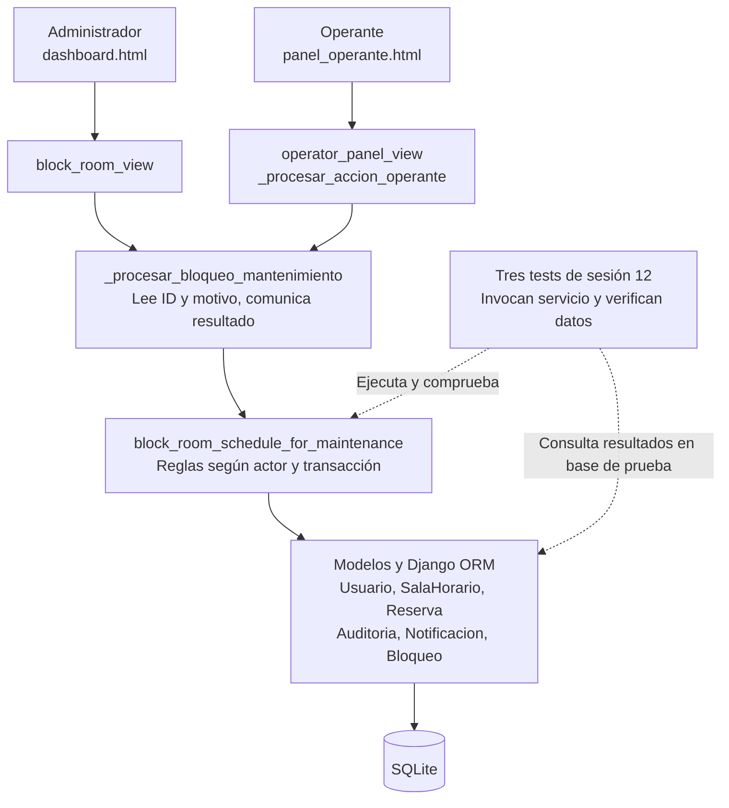

# Sesión 12 — Arquitectura y verificación del flujo

- **Proyecto e integrantes:** SalaMandra — Reserva de Salas de Estudio. Integrantes: Luciana Soza (@luci-solar34), Sebastian Cruz (@Sebas0032) y Sebastian Soto (@sebas-sst).
- **Fecha de la actividad original:** 13/10/2026.
- **Actualización documental:** 1 de noviembre de 2026.
- **Requisitos:** [Sesión 6](sesion-06-requisitos.md).
- **Historias y casos de uso:** [Sesión 7](sesion-07-modelos.md).
- **Plan:** [Sesiones 8–9](sesion-08-09-plan-salamandra_dias.md).
- **Arquitectura del sistema completo:** [arquitectura.md](arquitectura.md).
- **Matriz de funciones y tests:** [trazabilidad-pruebas.md](trazabilidad-pruebas.md).
- **Operación seleccionada:** bloqueo de un horario de sala por mantenimiento.
- **Casos relacionados según numeración actual:** RES-CU-10, mantenimiento administrativo, y RES-CU-07, mantenimiento del Operante. Los tres tests específicos de esta sesión utilizan un Administrador para éxito y repetición, y un Solicitante para rechazo.
- **Requisitos relacionados:** RES-RF-03, RES-RF-13 y RES-RF-17.
- **Issue original:** [Issue 29](https://github.com/Sebas0032/SalaMandra/issues/29).

## 1. Punto de partida y alcance

La actividad organizó tres escenarios esenciales del mantenimiento en `tests/sesion12/test_flujo_mantenimiento.py`: bloqueo exitoso, doble bloqueo y usuario sin permisos. El servicio `block_room_schedule_for_maintenance()` ya existía y tenía pruebas generales.

Se mantiene la intención de la sesión: separar un contrato pequeño y verificable y ejecutarlo automáticamente mediante `.github/workflows/ci-sesion12.yml`, conservando un reporte JUnit. Este documento describe ese flujo concreto. La arquitectura completa y el inventario general se mantienen en los documentos enlazados, evitando confundir tres escenarios de CI con toda la aplicación.

La revisión posterior consolidó cinco duplicaciones en la suite general. Las comprobaciones de bitácora y reservas futuras permanecen en los tests conservados. **No se modificaron el workflow ni los tres tests de sesión 12.**

## 2. Responsabilidades y dependencias

| Componente | Responsabilidad | Ubicación |
|---|---|---|
| Presentación administrativa | Recibir el formulario y mostrar mensajes o redirigir. | `dashboard.html`, `block_room_view()` y `_procesar_bloqueo_mantenimiento()`. |
| Presentación del Operante | Recibir la acción mantenimiento desde su propio panel. | `panel_operante.html`, `operator_panel_view()` y `_procesar_accion_operante()`. |
| Permisos | Comprobar sesión y rol antes de procesar la acción. | `cuentas/permisos.py` y comprobación del servicio. |
| Servicio | Aplicar reglas, actualizar reservas y registrar mantenimiento. | `reservas/services.py`, `block_room_schedule_for_maintenance()`. |
| Datos | Representar actor, bloque, reservas, auditorías, avisos y bloqueo. | `reservas/models.py` y ORM de Django. |
| Persistencia | Guardar los cambios de forma atómica. | SQLite configurada en `salamandra_project/settings.py`. |
| Pruebas del contrato | Verificar tres escenarios mediante el servicio y ORM de prueba. | `tests/sesion12/test_flujo_mantenimiento.py`. |
| CI | Ejecutar ese contrato y conservar evidencia por ejecución. | `.github/workflows/ci-sesion12.yml`. |

### Cohesión y acoplamiento

Las vistas leen datos y preparan la respuesta; el servicio centraliza reglas compartidas por Administrador y Operante; los modelos definen datos y restricciones. Ambos roles llaman al mismo servicio, pero el Operante solo puede bloquear antes del inicio y el Administrador tiene una excepción temporal.

Los tests específicos llaman directamente al servicio y consultan los modelos. Comprueban integración con persistencia y permisos de negocio sin abrir el navegador. No demuestran por sí solos el recorrido completo de la interfaz.

## 3. Interfaz del servicio

```python
block_room_schedule_for_maintenance(codigo_usuario_admin, id_sala_horario, motivo)
```

| Dato | Significado |
|---|---|
| `codigo_usuario_admin` | Código del actor autorizado. Aunque conserva ese nombre, admite Administrador u Operante activo. |
| `id_sala_horario` | Identificador de la combinación sala e intervalo. |
| `motivo` | Descripción obligatoria validada por el procesador del formulario. |
| Resultado | Diccionario con `sala_horario` y `reservas_canceladas`. |

En caso de éxito cambia el bloque a `MANTENIMIENTO`, las reservas confirmadas asociadas a `POR_MANTENIMIENTO`, crea auditorías y notificaciones y registra `Bloqueo`, sin sancionar a los titulares. La consulta abarca todas las fechas asociadas, no solamente hoy.

La transacción confirma el conjunto o revierte ante un error. Los rechazos previstos incluyen `NotAuthorizedError`, `ScheduleNotFoundError`, `ScheduleAlreadyBlockedError` y, para el Operante fuera de plazo, `MaintenanceAlreadyStartedError`.

El bloqueo persiste hasta un desbloqueo autorizado. Ambos roles solo pueden retirarlo antes del inicio del turno en la fecha original del bloqueo; la habilitación no restaura reservas afectadas.

## 4. Arquitectura del flujo



Las flechas representan dependencias o invocaciones, no respuestas cronológicas. Para las respuestas, alternativas y redirecciones se utilizan los diagramas de secuencia de [sesión 07](sesion-07-modelos.md). Las pruebas no son un componente llamado por la aplicación.

## 5. Trazabilidad de los tres escenarios actuales de CI

Todos pertenecen a `tests/sesion12/test_flujo_mantenimiento.py`, están marcados `integration` y verifican `block_room_schedule_for_maintenance()`.

| Escenario | Test actual | Qué comprueba |
|---|---|---|
| Aceptación | `test_bloqueo_exitoso_cambia_reserva_sin_sancionar` | Estado del horario y reserva, responsable y motivo del bloqueo, ausencia de sanción. |
| Repetición | `test_doble_bloqueo_no_crea_otro_registro` | Segundo intento lanza `ScheduleAlreadyBlockedError` y conserva un solo bloqueo. |
| Sin permiso | `test_solicitante_sin_permiso_no_modifica_el_horario` | Lanza `NotAuthorizedError`, conserva horario y reserva y no crea bloqueo ni sanción. |

La [matriz general](trazabilidad-pruebas.md) relaciona las demás operaciones con sus vistas, servicios y pruebas. Los nombres antiguos `test_bloqueo_exitoso_y_cancelacion_sin_sancion`, `test_impide_doble_bloqueo` y `test_estudiante_no_puede_bloquear` corresponden a pruebas generales consolidadas posteriormente, no a los nombres actuales de esta carpeta.

## 6. Ejecución y resultados locales

```bash
# Contrato específico
python -m pytest tests/sesion12/test_flujo_mantenimiento.py -v

# Suite completa
python -m pytest -q
```

La última verificación local completa de esta revisión obtuvo **104 passed in 166.99s** el 1 de noviembre de 2026. Incluye los tres escenarios del contrato. La distribución por marcas es 83 `unit`, 16 `integration` y 5 `e2e`, con las limitaciones de clasificación explicadas en la matriz general. No se declara un resultado local nuevo en cada consulta de este documento.

El registro original de la actividad indicaba 7 pruebas de mantenimiento aprobadas y 3 específicas aprobadas en 0.27 s. Es información histórica de aquella versión, no el conteo actual tras la consolidación. No se equiparan los resultados de distintas versiones o entornos.

### Alcance no comprobado por este contrato

Los tres tests de CI no demuestran concurrencia real entre peticiones, ejecución de JavaScript, presentación responsive ni despliegue de producción. Los tests HTTP de la suite completa usan el cliente de Django, no un navegador real.

## 7. GitHub Actions y evidencia histórica

El workflow actual se activa en push, pull request y ejecución manual. Usa un runner Ubuntu con Python 3.13, instala `requirements.txt` y ejecuta únicamente:

```bash
python -m pytest tests/sesion12 -q --junitxml=evidencias/sesion12-junit.xml
```

Conserva el XML como artefacto durante 14 días. En una ejecución exitosa de `main`, también genera mediante `git archive` un ZIP del código fuente como candidato para revisión. **No ejecuta los 104 tests ni despliega la aplicación.** El runner es un entorno temporal de pruebas, no el servidor de producción.

### Referencias conservadas de la actividad original

Estas referencias provienen del documento anterior. No se verificó de nuevo su contenido remoto ni la disponibilidad actual de los artefactos durante esta actualización:

- [Ejecución histórica 38484863987](https://github.com/Sebas0032/SalaMandra/actions/runs/38484863987), registrada entonces con tres pruebas aprobadas.
- Commit registrado como probado: `2577cbd`.
- Reporte registrado: `resultados-sesion12-38484863987-1`.
- Candidato registrado: `candidato-sesion12-5196c3e1e8a8e6a30b5bc9e9abdb3cecc1cd8d3d`.
- [PR de pruebas y CI #42](https://github.com/Sebas0032/SalaMandra/pull/42) y [PR de documentación #43](https://github.com/Sebas0032/SalaMandra/pull/43).

Cada evidencia debe asociarse a su propio SHA y ejecución; estos identificadores históricos no certifican la versión de la suite actual. Una comprobación actual de CI requiere revisar la ejecución del commit que se pretenda entregar y su XML.

## 8. Plan y participación

La actividad conserva su foco en mantenimiento y su contrato de tres escenarios. Para entregar la revisión actual se debe registrar el commit que incorpora la documentación y, cuando esté disponible, el enlace de su ejecución de CI. El workflow y sus pruebas permanecen sin cambios.

### Aportes individuales

- **Luciana Soza:** Participó en la organización de las pruebas específicas del flujo de bloqueo por mantenimiento y en la elaboración de la documentación correspondiente a la sesión 12.
- **Sebastian Cruz:** Colaboró en el desarrollo e integración de los componentes del proyecto SalaMandra relacionados con la gestión de reservas y mantenimiento.
- **Sebastian Soto:** Participó en el trabajo colaborativo del proyecto, apoyando las actividades de implementación, revisión e integración de los cambios correspondientes a la sesión 12.

### Asistencia de IA

Se utilizó ChatGPT como apoyo para estructurar el workflow, organizar las pruebas específicas y redactar este documento.

## 9. Navegación y enlaces de entrega

- [Arquitectura general](arquitectura.md).
- [Trazabilidad de funciones y tests](trazabilidad-pruebas.md).
- [Recorridos Persona → Presentación → Lógica → Resultado](session20.md).
- [Workflow en el repositorio](../.github/workflows/ci-sesion12.yml).
- [Tests del contrato](../tests/sesion12/test_flujo_mantenimiento.py).
- [Pruebas generales de mantenimiento](../tests/tests_mantenimiento.py).
- [Documento en GitHub](https://github.com/Sebas0032/SalaMandra/blob/main/docs/sesion-12-arquitectura.md).

### Hallazgo principal de la sesión

Separar un contrato pequeño permite reconocer y ejecutar automáticamente los escenarios esenciales del mantenimiento. La arquitectura general explica dónde se ubica ese contrato, y la matriz de trazabilidad distingue qué funciones comprueba y qué parte de la suite queda fuera del workflow.
