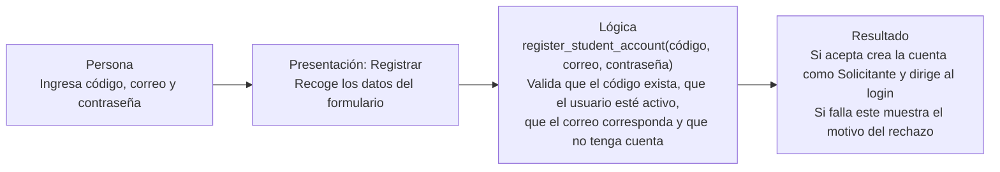
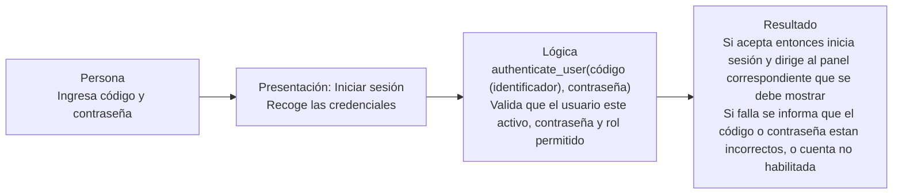

# Sesión 20 — Recorrido de registro e inicio de sesión

## Registrar cuenta

La presentación recoge los datos, la lógica aplica las reglas de registro y la presentación comunica si la cuenta fue creada o rechazada.

## Iniciar sesión

La presentación recoge las credenciales, la lógica comprueba la cuenta y la presentación comunica el resultado o dirige al usuario a su panel.
