# Sesión 20 — Recorridos de interacción del sistema

Cada recorrido utiliza cuatro campos: **Persona → Presentación → Lógica → Resultado**. La persona inicia la acción, la presentación recibe sus datos, la lógica aplica las reglas y la presentación comunica el resultado. Los rechazos no deben dejar cambios parciales.

Las referencias a la presentación incluyen el HTML y la vista que lo atiende. Los recorridos cubren las funciones actuales seleccionadas para esta sesión; la gestión de salas y horarios corresponde a futuros alcances.

Documentación relacionada: [arquitectura general](arquitectura.md) y [trazabilidad de pruebas](trazabilidad-pruebas.md).

## Registrar cuenta

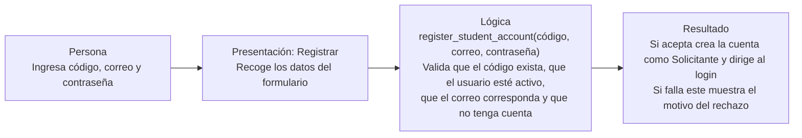

La presentación recoge los datos, la lógica aplica las reglas de registro y la presentación comunica si la cuenta fue creada o rechazada.

## Iniciar sesión

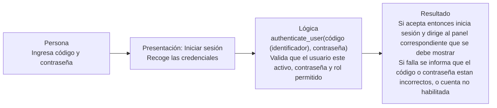

La presentación recoge las credenciales, la lógica comprueba la cuenta y la presentación comunica el resultado o dirige al usuario a su panel.

## Consultar salas, horarios y reservas propias

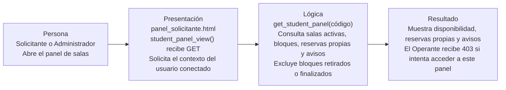

La consulta no crea reservas. Tener una sanción vigente permite consultar, pero impide crear o modificar reservas.

## Crear una reserva propia

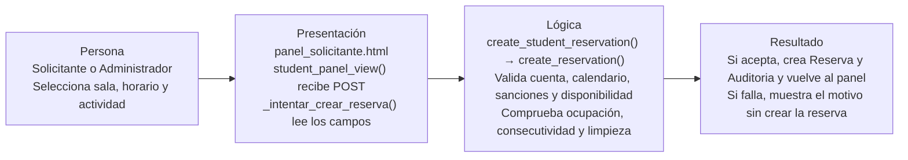

Actor y titular son el mismo usuario. El Administrador que reserva para sí mismo está exceptuado de la restricción de mismo horario y bloques consecutivos. La regla de calendario prohíbe reservar sábados, domingos y feriados configurados.

## Modificar una reserva como Solicitante o Administrador

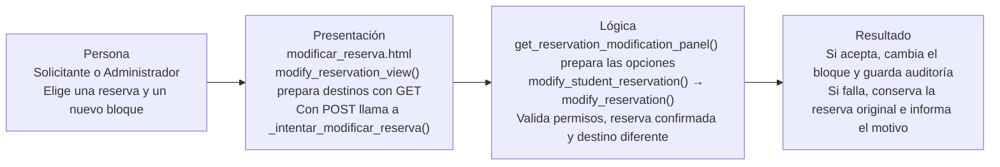

El Solicitante necesita al menos 60 minutos de anticipación. El Administrador omite ese plazo y la restricción de consecutividad, pero respeta disponibilidad, sanciones, mantenimiento y limpieza. Si modifica una reserva ajena, se notifica al titular y vuelve a gestión de reservas; si es propia, vuelve al panel de salas.

## Cancelar una reserva propia

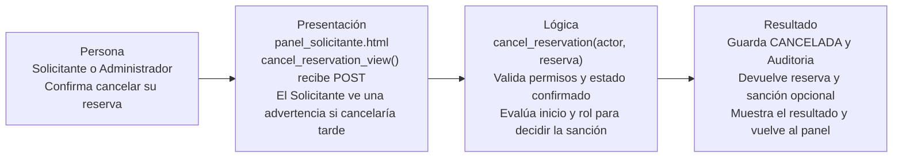

El Solicitante solo cancela antes del inicio: con 60 minutos o más no hay sanción; con menos de 60 minutos, _registrar_sancion_por_cancelacion() cuenta las faltas automáticas y aplica 24 horas, 48 horas, 168 horas o semestre. Las duraciones fijas omiten sábados y domingos. El Administrador puede cancelar una reserva propia confirmada incluso iniciada y no recibe sanción automática. Si se rechaza la operación, no cambia la reserva ni aumenta el contador.

## Marcar una notificación como leída

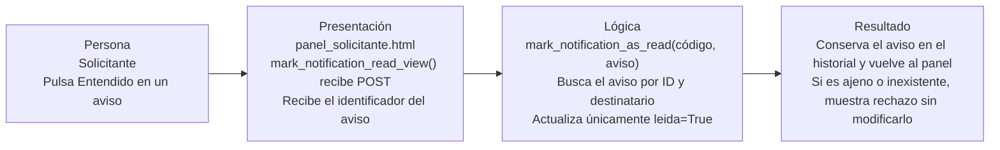

Los avisos persistentes son distintos de los mensajes temporales de éxito o error mostrados al enviar un formulario.

## Buscar un Solicitante desde el panel del Operante

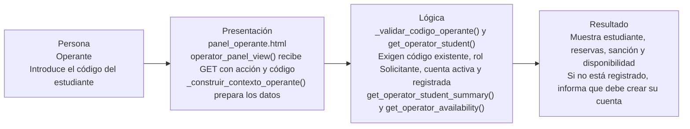

Una fila precargada sin contraseña no basta. La comprobación también se aplica en los servicios al crear, modificar o cancelar, aunque se envíe la operación sin usar el buscador.

## Crear una reserva asistida

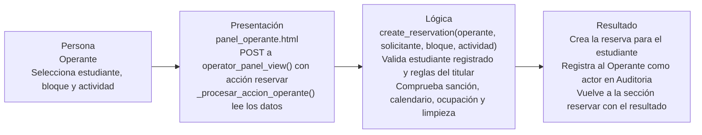

El titular y el actor son distintos. El Operante no obtiene la excepción administrativa de consecutividad.

## Modificar una reserva asistida

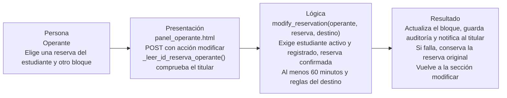

Para mostrar las opciones se utiliza get_reservation_modification_panel_for_actor(). El Operante tiene permiso para gestionar reservas ajenas, pero no está exceptuado del plazo ni de la consecutividad.

## Cancelar una reserva asistida

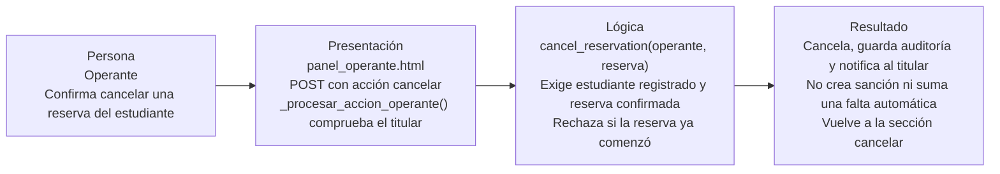

La ausencia de sanción depende del actor Operante: aunque falten menos de 60 minutos, no se sanciona al titular. Si el plazo de inicio ya pasó, la cancelación se rechaza.

## Consultar reservas desde la gestión administrativa

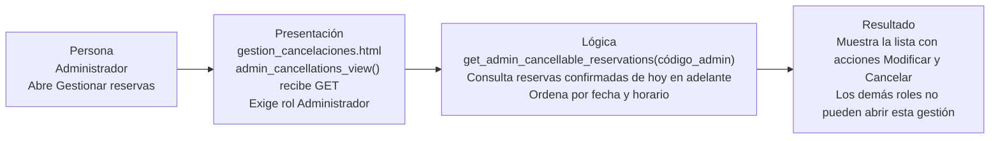

La modificación administrativa utiliza el recorrido de modify_reservation_view() descrito antes, con las excepciones del Administrador.

## Cancelar una reserva desde la gestión administrativa

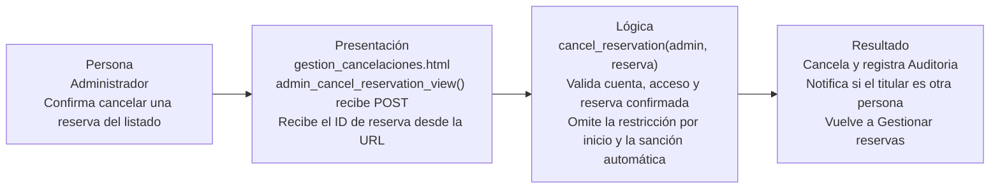

No aumenta el contador de faltas automáticas. Si la reserva ya está cancelada, afectada por mantenimiento o no existe, se rechaza sin repetir la operación.

## Bloquear un horario por mantenimiento

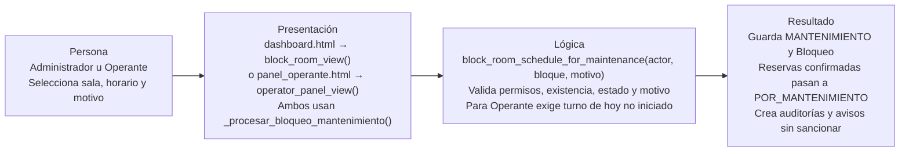

El Administrador puede bloquear incluso un turno iniciado o finalizado. Se afectan las reservas confirmadas de la combinación en todas sus fechas. El Administrador vuelve al dashboard y el Operante a su sección de mantenimiento. Un bloqueo no desaparece al terminar el turno.

## Retirar un bloqueo de mantenimiento

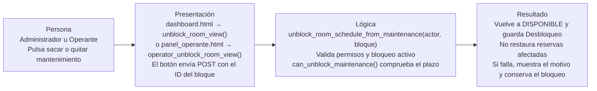

Ambos roles solo pueden retirar antes del inicio del horario en la fecha original del bloqueo. La redirección vuelve a la pantalla de mantenimiento correspondiente al rol.

## Consultar sanciones

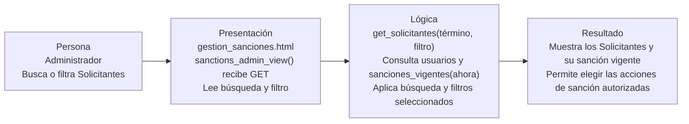

La consulta es de lectura. La presentación utiliza los datos devueltos para mostrar el motivo, vencimiento y opciones de gestión.

## Aplicar una sanción manual

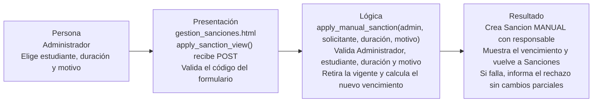

Las duraciones fijas omiten sábados y domingos; semestre vence el próximo 1 de enero o julio. La sanción manual no suma faltas automáticas ni crea un aviso persistente para el estudiante. Al intentar crear o modificar una reserva, este recibe un mensaje con motivo y fecha y hora de vencimiento en La Paz.

## Retirar una sanción individual

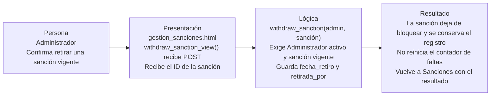

La fecha de fin original no se sobrescribe. Un segundo retiro o una sanción inexistente o no vigente se rechaza.

## Reiniciar sanciones y contadores

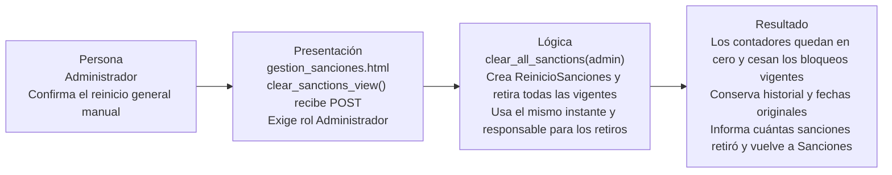

La misma fecha y hora se guarda en ReinicioSanciones.fecha y fecha_retiro de las sanciones manuales y automáticas vigentes. contar_faltas() considera solo faltas automáticas posteriores al corte. El cambio semestral automático se calcula por fechas y no es una acción iniciada desde esta pantalla.

## Cerrar sesión

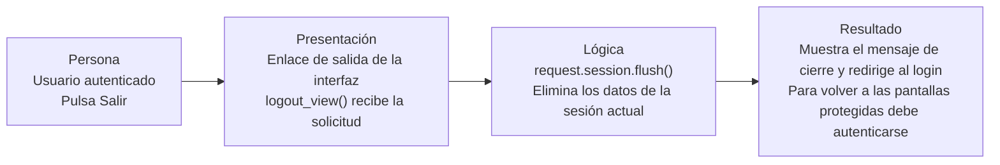

El cierre de sesión no elimina la cuenta ni las reservas del usuario.
